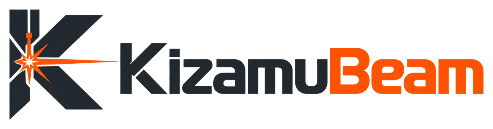

<p align="center">
  <picture>
    <source media="(prefers-color-scheme: dark)" srcset="docs/brand/kizamubeam-logo-dark.png">
    
  </picture>
</p>

<p align="center">
  <b>Entwerfen, gravieren, schneiden. Freie Laser-Software für macOS, Windows und Linux.</b>
</p>

<p align="center">
  <a href="https://github.com/negurvulkan/kizamubeam/releases"><b>Herunterladen</b></a> ·
  <a href="https://negurvulkan.github.io/kizamubeam/">Website</a> ·
  <a href="https://negurvulkan.github.io/kizamubeam/docs/de/">Handbuch</a> ·
  <a href="docs/features.de.md">Alle Funktionen</a> ·
  <a href="https://discord.gg/SSr8VHh7EJ">Discord</a> ·
  <a href="README.md">English</a> ·
  <a href="README.it.md">Italiano</a>
</p>

KizamuBeam bringt dich in einer App von der Idee zum fertigen Stück: direkt auf der Arbeitsfläche zeichnen und schreiben, Fotos in Gravuren verwandeln, Boxen, Zahnräder und Steckmodelle erzeugen, alles in 3D prüfen und den Auftrag direkt an den Laser schicken. Wer LightBurn kennt, findet sich sofort zurecht.

KizamuBeam ist Open Source (GPL-3.0), kostenlos und braucht weder Konto noch Lizenzschlüssel.

<p align="center">
  
</p>

## Herunterladen

| System | Datei |
|---|---|
| **macOS** (Apple Silicon und Intel) | `KizamuBeam_…_universal.dmg` |
| **Windows** (64 Bit) | `KizamuBeam_…_x64-setup.exe` |
| **Linux** (64 Bit) | `KizamuBeam_…_amd64.AppImage`, `.deb` oder `.rpm` |

Die aktuelle Version gibt es auf der [Release-Seite](https://github.com/negurvulkan/kizamubeam/releases) und auf der [Website](https://negurvulkan.github.io/kizamubeam/#download). Aktuelle Version: **2.8.0** (stabil). Einmal installiert, hält sich KizamuBeam selbst aktuell (Hilfe → Nach Updates suchen).

> **Erster Start unter macOS:** Meldet macOS, dass die App nicht überprüft werden kann, unter Systemeinstellungen → Datenschutz & Sicherheit auf „Dennoch öffnen“ klicken.

## Was du damit machen kannst

### Direkt in der App gestalten
Linien, Kurven, Formen und Text in jeder Schrift, auch alle Google Fonts mit einem Klick. Formen kombinieren, versetzen, Knoten bearbeiten (auch über mehrere Objekte hinweg), Pfade vereinfachen und glätten, Text an einem Pfad entlang laufen lassen, Ecken runden. Fangpunkte, Ausrichten, Arrays und automatisches Verschachteln halten Ordnung, und jedes Ergebnis bleibt eine saubere, bearbeitbare Kurve. Eine Bibliothek mit **400 mitgelieferten Motiven und Designelementen** hilft beim Einstieg.

### Eigene Vorlagen übernehmen
SVG, DXF, PDF und Illustrator-Dateien, LightBurn-Projekte (`.lbrn2`) und alle gängigen Bildformate öffnen. Fotos bekommen Rasterung, Zeitungsdruck- und Skizzen-Effekt, Hintergrund entfernen, Zuschneiden und Masken und lassen sich in Vektoren nachzeichnen, auch als Mittellinien für Gravuren mit einem Strich.

### Bauteile erzeugen statt zeichnen
Maße eingeben, fertige Teile bekommen: **Boxen mit Fingerzinken, Schubladen, Einsätze, Steckregale, Zahnräder, Zahnstangen, Riemenscheiben, Nocken und Deckelscharniere**. Verbindungen, Schlitze und Biegeschnitte lassen sich an jede Form setzen. 3D-Modelle (STL/OBJ) werden zu Schicht-, Rippen- oder Scheibenmodellen aus flachen Teilen. Später genügt ein Doppelklick auf ein Teil, um es zu ändern, und alles wird neu berechnet.

<p align="center">
  
</p>

### Sehen, bevor es brennt
Die **3D-Ansicht** setzt die Teile so zusammen, wie sie später gebaut werden, mit Material, Maserung und Gravuren, und zeigt, ob etwas kollidiert. **Konstruktion prüfen** findet offene Formen, zu feine Details und Passungsprobleme vor dem Start. Die **Vorschau** spielt den Auftrag ab und schätzt die Laufzeit genau.

<p align="center">
  
</p>

### Den Laser steuern
Läuft mit **FluidNC, GRBL, grblHAL, Marlin und Smoothieware**, per USB oder WLAN. Ein Einrichtungsassistent erkennt die Steuerung, prüft ihre Einstellungen und fährt einen ersten Testauftrag. Rahmen fahren, starten, pausieren, Leistung und Tempo während des Laserns anpassen, an beliebiger Stelle im Auftrag einsteigen. Vor jedem Auftrag prüft KizamuBeam, ob alles auf das Bett passt. Drehachse (Rotary), motorisierte Z-Achse und Air Assist werden unterstützt.

### Die richtigen Einstellungen finden
Eine Material-Bibliothek speichert bewährte Einstellungen. Materialtest, Fokustest und Passungs-Kalibrierung helfen, sie zu finden, und ein Test lässt sich direkt aus einem Foto auswerten. Je Layer: mehrere Durchgänge, Sub-Layer, Haltestege, Schnittbreitenausgleich, Perforation, Anschnitt und Leistungsrampe.

### In Serie fertigen
Vorlagen mit Parametern, variabler Text und Seriennummern aus CSV, QR-Codes und Strichcodes, mehrseitige Projekte, Jigs für ganze Ladungen von Rohlingen, **Print and Cut** mit Passermarken und eine Kamera, um Motive direkt auf dem Werkstück zu platzieren.

### Nach deinem Geschmack
Andockbare Fenster und anpassbare Werkzeugleisten, helles und dunkles Design, Deutsch, Englisch und Italienisch. Der Werkzeugkasten sammelt alle Generatoren und Spezialwerkzeuge an einem Ort. Erweiterungen bringen Gerätevorlagen, Vorlagen, Materialien und Motive mit. Einstellungen, Geräte und Bibliotheken lassen sich als Datei sichern und übertragen oder über einen eigenen Ordner (iCloud, Dropbox, Nextcloud) zwischen Rechnern synchronisieren. KI-Agenten wie Claude Code oder Codex können über den eingebauten MCP-Server mit deinem Projekt arbeiten, mit der Berechtigungsstufe, die du wählst.

**→ [Die vollständige Funktionsliste](docs/features.de.md)**

## Selbst bauen

Du brauchst Node.js 20+ und Rust (stable), unter Linux zusätzlich die [Tauri-Voraussetzungen](https://v2.tauri.app/start/prerequisites/).

```bash
npm install
npm run tauri dev      # Desktop-App mit Live-Neuladen
npm run tauri build    # Installer für dein System
```

Releases, Updates, Übersetzungen und der Aufbau des Codes stehen im [Entwickler-Handbuch](docs/development.de.md). Beiträge sind willkommen, siehe [CONTRIBUTING.md](CONTRIBUTING.md); wie du KizamuBeam in deine Sprache übersetzt, steht in [TRANSLATION.md](TRANSLATION.md) (englisch).

## Community

Fragen, Ideen oder etwas, das du mit KizamuBeam gemacht hast? Komm auf unseren [Discord-Server](https://discord.gg/SSr8VHh7EJ). Fehler und Wünsche meldest du am besten als [GitHub-Issue](https://github.com/negurvulkan/kizamubeam/issues).

## Mitwirkende

Danke an alle, die mitgeholfen haben ([Emoji-Legende](https://allcontributors.org/docs/en/emoji-key)). Code, Übersetzungen, Tests an echten Maschinen, Fehlerberichte und Ideen zählen gleichermaßen. Wie man aufgenommen wird, steht in [CONTRIBUTING.md](CONTRIBUTING.md#credits).

<!-- ALL-CONTRIBUTORS-LIST:START - Do not remove or modify this section -->
<!-- prettier-ignore-start -->
<!-- markdownlint-disable -->
<table>
  <tbody>
    <tr>
      <td align="center" valign="top" width="14.28%"><a href="https://github.com/negurvulkan"><br /><sub><b>Hanjo Winter</b></sub></a><br /><a href="#projectManagement-negurvulkan" title="Project Management">📆</a> <a href="#maintenance-negurvulkan" title="Maintenance">🚧</a> <a href="https://github.com/negurvulkan/kizamubeam/commits?author=negurvulkan" title="Code">💻</a> <a href="https://github.com/negurvulkan/kizamubeam/commits?author=negurvulkan" title="Documentation">📖</a> <a href="#design-negurvulkan" title="Design">🎨</a> <a href="#ideas-negurvulkan" title="Ideas, Planning, & Feedback">🤔</a> <a href="https://github.com/negurvulkan/kizamubeam/commits?author=negurvulkan" title="Tests">⚠️</a> <a href="#translation-negurvulkan" title="Translation">🌍</a></td>
      <td align="center" valign="top" width="14.28%"><a href="https://github.com/liquid-light"><br /><sub><b>liquid-light</b></sub></a><br /><a href="https://github.com/negurvulkan/kizamubeam/commits?author=liquid-light" title="Code">💻</a> <a href="#ideas-liquid-light" title="Ideas, Planning, & Feedback">🤔</a> <a href="https://github.com/negurvulkan/kizamubeam/issues?q=author%3Aliquid-light" title="Bug reports">🐛</a> <a href="https://github.com/negurvulkan/kizamubeam/commits?author=liquid-light" title="Tests">⚠️</a></td>
      <td align="center" valign="top" width="14.28%"><a href="https://github.com/SimoCassan"><br /><sub><b>SimoCassan</b></sub></a><br /><a href="#translation-SimoCassan" title="Translation">🌍</a> <a href="https://github.com/negurvulkan/kizamubeam/commits?author=SimoCassan" title="Code">💻</a></td>
      <td align="center" valign="top" width="14.28%"><a href="https://github.com/Asiak3"><br /><sub><b>Asiak C.</b></sub></a><br /><a href="https://github.com/negurvulkan/kizamubeam/commits?author=Asiak3" title="Code">💻</a> <a href="#ideas-Asiak3" title="Ideas, Planning, & Feedback">🤔</a> <a href="https://github.com/negurvulkan/kizamubeam/issues?q=author%3AAsiak3" title="Bug reports">🐛</a></td>
      <td align="center" valign="top" width="14.28%"><a href="https://github.com/Pietrogramma"><br /><sub><b>Pietrogramma</b></sub></a><br /><a href="#translation-Pietrogramma" title="Translation">🌍</a> <a href="https://github.com/negurvulkan/kizamubeam/commits?author=Pietrogramma" title="Code">💻</a></td>
    </tr>
  </tbody>
</table>

<!-- markdownlint-restore -->
<!-- prettier-ignore-end -->

<!-- ALL-CONTRIBUTORS-LIST:END -->

## Lizenz

KizamuBeam ist freie Software unter der [GNU General Public License v3.0 oder neuer](LICENSE). Gebaut mit Tauri 2, TypeScript und Rust. „Kizamu“ (刻む) ist japanisch und heißt einritzen, gravieren, fein schneiden.

Copyright © 2026 [Hanjo Winter](https://github.com/negurvulkan). Entwickelt mit Unterstützung von [Claude Code](https://claude.com/claude-code).

## Marken

LightBurn ist eine Marke der LightBurn Software, LLC. KizamuBeam ist ein unabhängiges Projekt und steht in keiner Verbindung zu LightBurn Software; es wird von dort weder unterstützt noch empfohlen.
