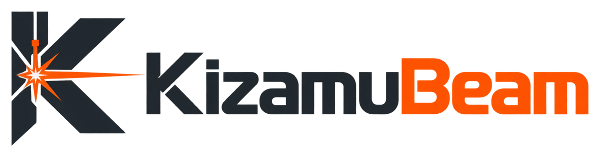

# KizamuBeam

<p align="center">
  <picture>
    <source media="(prefers-color-scheme: dark)" srcset="docs/brand/kizamubeam-logo-dark.png">
    
  </picture>
</p>

<p align="center">
  <b>Design, engrave, cut. Free laser software for macOS, Windows and Linux.</b>
</p>

<p align="center">
  <a href="https://github.com/negurvulkan/kizamubeam/releases"><b>Download</b></a> ·
  <a href="https://negurvulkan.github.io/kizamubeam/en/">Website</a> ·
  <a href="https://negurvulkan.github.io/kizamubeam/docs/">Manual</a> ·
  <a href="docs/features.md">All features</a> ·
  <a href="https://discord.gg/SSr8VHh7EJ">Discord</a> ·
  <a href="README.de.md">Deutsch</a> ·
  <a href="README.it.md">Italiano</a>
</p>

KizamuBeam takes you from the first idea to the finished piece in one app: draw and write directly on the workspace, turn photos into engravings, generate boxes, gears and slot-together models, check everything in 3D and send the job straight to your laser. If you have used LightBurn before, you will feel at home right away.

It is open source (GPL-3.0), free of charge, and needs no account or license key.

<p align="center">
  
</p>

## Download

| System | File |
|---|---|
| **macOS** (Apple Silicon and Intel) | `KizamuBeam_…_universal.dmg` |
| **Windows** (64-bit) | `KizamuBeam_…_x64-setup.exe` |
| **Linux** (64-bit) | `KizamuBeam_…_amd64.AppImage`, `.deb` or `.rpm` |

Get the latest version from the [releases page](https://github.com/negurvulkan/kizamubeam/releases) or the [website](https://negurvulkan.github.io/kizamubeam/en/#download). Current version: **2.8.0** (stable). Once installed, KizamuBeam keeps itself up to date (Help → Check for Updates).

> **First start on macOS:** if macOS says the app cannot be checked, open System Settings → Privacy & Security and click “Open Anyway”.

## What you can do with it

### Design right in the app
Lines, curves, shapes and text with any font, including all Google Fonts at a click. Combine shapes, offset them, edit nodes (across several objects at once), simplify and smooth paths, bend text along a path, round corners. Snapping, alignment, arrays and automatic nesting keep things tidy, and every result stays a clean, editable curve. A library with **400 built-in motifs and design elements** gets you started.

### Bring in your artwork
Open SVG, DXF, PDF and Illustrator files, LightBurn projects (`.lbrn2`) and all common image formats. Photos get dithering, newsprint and sketch effects, background removal, cropping and masks, and can be traced into vectors, including centerlines for single-stroke engraving.

### Generate parts instead of drawing them
Enter dimensions and get finished parts: **boxes with finger joints, drawers, dividers, shelves, gears, racks, pulleys, cams and lid hinges**. Joints, slots and living hinges can be added to any shape. Turn 3D models (STL/OBJ) into layered, rib or disc models made of flat parts. Double-click a part later to change it, and everything recalculates.

<p align="center">
  
</p>

### See it before you burn it
The **3D view** puts parts together exactly as they will be assembled, with material, texture and engravings, and shows whether anything collides. The **design check** finds open shapes, tiny details and fit problems before you start. The **preview** plays back the job with an accurate time estimate.

<p align="center">
  
</p>

### Run your laser
Works with **FluidNC, GRBL, grblHAL, Marlin and Smoothieware**, over USB or Wi-Fi. A setup wizard detects your controller, checks its settings and runs a first test job. Frame, start, pause, adjust power and speed while lasering, start from anywhere in the job. Before every job, KizamuBeam checks that everything fits on the bed. Rotary attachments, a motorized Z axis and air assist are supported.

### Get the settings right
A material library stores proven settings. Material tests, focus tests and a fit calibration help you find them, and a test can be evaluated straight from a photo. Per layer: multiple passes, sub-layers, tabs, kerf compensation, perforation, lead-ins and power ramps.

### Produce in batches
Templates with parameters, variable text and serial numbers from CSV, QR codes and barcodes, multi-page projects, jigs for batches of blanks, **Print and Cut** with registration marks and a camera to place designs right on the workpiece.

### Make it yours
Dockable windows and customizable toolbars, light and dark theme, English, German and Italian. A Toolbox gathers all generators and special tools in one place. Extensions add device presets, templates, materials and motifs. Settings, devices and libraries can be backed up or transferred as a file, or synced between computers through your own folder (iCloud, Dropbox, Nextcloud). AI agents such as Claude Code or Codex can work with your project through the built-in MCP server, with the access level you choose.

**→ [The complete feature list](docs/features.md)**

## Build it yourself

You need Node.js 20+ and Rust (stable); on Linux also the [Tauri prerequisites](https://v2.tauri.app/start/prerequisites/).

```bash
npm install
npm run tauri dev      # desktop app with live reload
npm run tauri build    # installer for your system
```

Releases, updates, translations and the code structure are described in the [developer guide](docs/development.md). Contributions are welcome, see [CONTRIBUTING.md](CONTRIBUTING.md); to translate KizamuBeam into your language, see [TRANSLATION.md](TRANSLATION.md).

## Community

Questions, ideas or something you made with KizamuBeam? Join us on [Discord](https://discord.gg/SSr8VHh7EJ). Bugs and feature requests are best filed as [GitHub issues](https://github.com/negurvulkan/kizamubeam/issues).

## Contributors

Thanks go to these wonderful people ([emoji key](https://allcontributors.org/docs/en/emoji-key)). Code, translations, testing on real machines, bug reports and ideas all count. See [CONTRIBUTING.md](CONTRIBUTING.md#credits) for how to be added.

<!-- ALL-CONTRIBUTORS-LIST:START - Do not remove or modify this section -->
<!-- prettier-ignore-start -->
<!-- markdownlint-disable -->
<table>
  <tbody>
    <tr>
      <td align="center" valign="top" width="14.28%"><a href="https://github.com/negurvulkan"><br /><sub><b>Hanjo Winter</b></sub></a><br /><a href="#projectManagement-negurvulkan" title="Project Management">📆</a> <a href="#maintenance-negurvulkan" title="Maintenance">🚧</a> <a href="https://github.com/negurvulkan/kizamubeam/commits?author=negurvulkan" title="Code">💻</a> <a href="https://github.com/negurvulkan/kizamubeam/commits?author=negurvulkan" title="Documentation">📖</a> <a href="#design-negurvulkan" title="Design">🎨</a> <a href="#ideas-negurvulkan" title="Ideas, Planning, & Feedback">🤔</a> <a href="https://github.com/negurvulkan/kizamubeam/commits?author=negurvulkan" title="Tests">⚠️</a> <a href="#translation-negurvulkan" title="Translation">🌍</a></td>
      <td align="center" valign="top" width="14.28%"><a href="https://github.com/liquid-light"><br /><sub><b>liquid-light</b></sub></a><br /><a href="https://github.com/negurvulkan/kizamubeam/commits?author=liquid-light" title="Code">💻</a> <a href="#ideas-liquid-light" title="Ideas, Planning, & Feedback">🤔</a> <a href="https://github.com/negurvulkan/kizamubeam/issues?q=author%3Aliquid-light" title="Bug reports">🐛</a> <a href="https://github.com/negurvulkan/kizamubeam/commits?author=liquid-light" title="Tests">⚠️</a></td>
      <td align="center" valign="top" width="14.28%"><a href="https://github.com/SimoCassan"><br /><sub><b>SimoCassan</b></sub></a><br /><a href="#translation-SimoCassan" title="Translation">🌍</a> <a href="https://github.com/negurvulkan/kizamubeam/commits?author=SimoCassan" title="Code">💻</a></td>
      <td align="center" valign="top" width="14.28%"><a href="https://github.com/Asiak3"><br /><sub><b>Asiak C.</b></sub></a><br /><a href="https://github.com/negurvulkan/kizamubeam/commits?author=Asiak3" title="Code">💻</a> <a href="#ideas-Asiak3" title="Ideas, Planning, & Feedback">🤔</a> <a href="https://github.com/negurvulkan/kizamubeam/issues?q=author%3AAsiak3" title="Bug reports">🐛</a></td>
      <td align="center" valign="top" width="14.28%"><a href="https://github.com/Pietrogramma"><br /><sub><b>Pietrogramma</b></sub></a><br /><a href="#translation-Pietrogramma" title="Translation">🌍</a> <a href="https://github.com/negurvulkan/kizamubeam/commits?author=Pietrogramma" title="Code">💻</a></td>
    </tr>
  </tbody>
</table>

<!-- markdownlint-restore -->
<!-- prettier-ignore-end -->

<!-- ALL-CONTRIBUTORS-LIST:END -->

## License

KizamuBeam is free software under the [GNU General Public License v3.0 or later](LICENSE). Built with Tauri 2, TypeScript and Rust. “Kizamu” (刻む) is Japanese for to carve, to engrave, to cut finely.

Copyright © 2026 [Hanjo Winter](https://github.com/negurvulkan). Developed with assistance from [Claude Code](https://claude.com/claude-code).

## Trademarks

LightBurn is a trademark of LightBurn Software, LLC. KizamuBeam is an independent project and is not affiliated with or endorsed by LightBurn Software.
