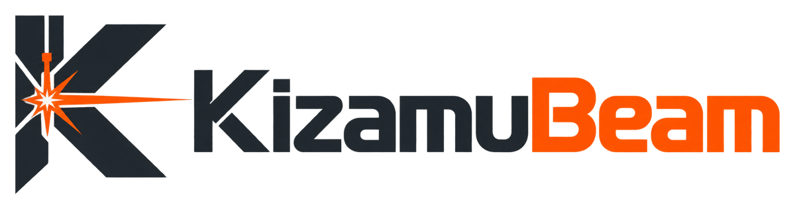

<p align="center">
  <picture>
    <source media="(prefers-color-scheme: dark)" srcset="docs/brand/kizamubeam-logo-dark.png">
    
  </picture>
</p>

# KizamuBeam

English · [Deutsch](README.de.md) · [Website](https://negurvulkan.github.io/kizamubeam/en/)

Free laser software for designing, editing images and sending jobs straight to the laser. The workflow follows LightBurn, so people switching over find their way around right away.
Stack: Tauri 2, TypeScript (UI, editor, G-code), Rust (desktop shell, machine connection, MCP server). License: GPL-3.0-or-later (see `LICENSE`). Version: 1.13.0-beta.

“Kizamu” (刻む) is Japanese for to carve, to engrave, to cut finely.

## Logo

Logo files are in [`docs/brand/`](docs/brand/): logo with symbol, wordmark, symbol in color and monochrome, symbol above the wordmark, each also as `-dark` for dark backgrounds, plus the app icon (`kizamubeam-app-icon.png`, source for `npx tauri icon`).

## Getting started

Requirements: Node.js 20+, Rust (stable), on Linux also `libwebkit2gtk-4.1-dev`, `librsvg2-dev`, `build-essential`, `libssl-dev`
(see https://v2.tauri.app/start/prerequisites/).

```bash
npm install
npm run tauri dev      # desktop app with live reload
npm run dev            # UI only, in the browser: http://localhost:1420
npm run tauri build    # installer package
```

On Windows, `npm run tauri build` only builds the NSIS installer (`.exe`, see `src-tauri/tauri.windows.conf.json`), because the MSI installer does not accept pre-release versions such as `1.13.0-beta`. On Linux it builds AppImage and .deb; RPM does not accept a hyphen in the version (see `src-tauri/tauri.linux.conf.json`).

Releases: publishing a release on GitHub (Releases → Draft a new release → new tag → Publish release) runs `.github/workflows/release.yml`, which builds the installers for macOS (universal, Apple Silicon and Intel), Windows (NSIS) and Linux (AppImage, .deb) and attaches them to that release. An already published release can be built with Actions → Release → Run workflow. The builds are not code-signed yet, so macOS and Windows show a warning on first launch.

Updates: Help → Check for Updates looks for a newer release on GitHub (channel Stable, or Beta including pre-releases; by default once a day at startup), verifies its signature and installs it. This needs an updater key pair (`npx tauri signer generate -w ~/.tauri/kizamubeam.key`): the private key as repository secret `TAURI_SIGNING_PRIVATE_KEY` (and its password as `TAURI_SIGNING_PRIVATE_KEY_PASSWORD`), the public key as repository variable `TAURI_UPDATER_PUBKEY`. Builds without the key cannot update themselves. On Linux, updating works for the AppImage.

## Features

- Familiar layout: menu, main toolbar, numeric edits toolbar at the top, tools on the left, Cuts / Layers and Laser on the right, color palette 00–29 plus T1/T2 at the bottom, status bar.
- Customizable interface:
  - Tool windows (Cuts / Layers, Objects, Laser, Move, Console, Material, Camera) can be docked individually. Drag a tab onto another tab header to add it as a tab, onto the top or bottom edge of a group to place it above or below, onto the left edge next to the tools toolbar for the left dock, or onto the workspace to make it a floating window (move by its header, resize at the bottom-right corner, ⇥ or double-click docks it on the right).
  - Size: the dividers between windows and the inner edge of the docks can be dragged. ▾ or a double-click on the header collapses a group.
  - × on a tab hides a window; the Window menu shows and hides windows and bars (Main Toolbar, Tools Toolbar, Numeric Edits Toolbar, Color Palette, Status Bar).
  - Customize toolbars (Window → Toolbars or right-click on the main or tools toolbar): add actions from every area, remove them, reorder by dragging or with ↑/↓, insert separators, icon size small/normal/large; actions without an icon appear as text. Button groups (zoom, mirror and rotate, align and distribute, Boolean operations, path tools, arrays) take a single slot: the button runs the most recently chosen action, the ▾ arrow next to it shows all of them. Older saved toolbars are merged into the groups automatically. “Restore defaults” resets a toolbar.
  - Layout and toolbars are saved per user (`localStorage`: `kizamubeam.layout`, `kizamubeam.toolbars`); Window → Reset Windows and Toolbars restores the initial state.
- Workspace as the machine bed in mm (default 400 × 400, adjustable in Device Settings), grid, rulers, origin at the bottom left, zoom with the mouse wheel, pan with the space bar or middle mouse button.
- Drawing: lines and Bézier curves, rectangle with corner radius, ellipse, polygon and star, text (multi-line, font, height, bold, italic, upper case, letter and line spacing, alignment).
- Editing: select by click and marquee (to the right: enclosing, to the left: crossing), move, scale, rotate with the mouse (drag just outside a corner or click the selection a second time; movable pivot, Shift 15°, Ctrl 5°, Esc cancels), numeric fields with a 9-point anchor and formulas with units (“100/3”, “2in”), node editing (select nodes by click, Shift+click, marquee or Ctrl+A, drag them together or nudge with the arrow keys; Del deletes, L line, C curve, E corner, S smooth, I insert, B break the path at the node, T trim the edge back to the intersections), Convert to Path, group, mirror, align, distribute, copy, duplicate, undo.
- Snapping (“Snap” and “Grid” in the status bar): to nodes, midpoints, centers, intersections and lines, and to the grid with adjustable spacing. Ctrl while dragging inverts snapping, Alt snaps more strongly and shows alignment guides on other objects.
- Arrays (Tools → Array → Grid Array, Ctrl+Shift+A, and Circular Array) with live preview: copies in columns and rows with gap or center spacing, direction, offset and mirroring of every other row/column, or in a circle around a center point. Bézier curves are preserved exactly.
- Nesting (Arrange → Nest …, also on the tools toolbar): arranges the selection by its real outlines, not just bounding boxes, to save material. Area: work area, a material size (width × height at a position) or a selected shape as the sheet, e.g. the outline of a scrap piece. Settings: spacing between parts and to the edge, rotation (none, 180° only, or in 90°/45°/15°/5° steps), the corner to start from and precision (fast, normal, thorough; normal and thorough try several part orders and keep the best). Small parts can go into holes of larger ones. Other objects on the page are avoided. What doesn't fit goes onto new pages after the current one (with a copy of the scrap shape if one is used). Objects that belong together move together: holes drawn as separate shapes, engravings and text on a part, text on path with its shape; parts that only partly overlap stay separate. Generator assemblies and joined parts keep their 3D assembly, also when spread over several pages. One undo step; `npm run test:nest` checks spacing, margins, holes and pages.
- **Design check** (Laser → Check Design, or Window → Design Check): checks the current page before lasering and marks every finding on the workspace. Clicking a finding selects the objects concerned and zooms to the spot; where possible a button fixes it (one undo step). Findings: lines that would be cut twice (a duplicate object is deleted, a shared edge is removed from the later part), outlines that are almost closed (gap up to 1 mm), single lines that form an outline but are not joined, lines on fill layers that would be skipped, bridges between two cuts narrower than the minimum bridge (default 1 mm, kerf width and kerf offset taken into account), cutouts too small for the kerf width or eaten up by the kerf offset, objects outside the work area (only with absolute coordinates), elements an SVG/DXF import skipped, and the fit of slot-together joints: boxes, drawers, inserts and shelves from the generators and joints made with the joint tool are checked against material thickness, kerf in the part, kerf offset of the layer and kerf width (too tight, very tight, very loose; a material thickness that differs from the layer's material is reported too). Once the material is calibrated, the check compares against the calibration, and a button applies the calibrated values to the part. Settings: minimum bridge, kerf width (used when a layer has no kerf offset), gap for accidentally open outlines, layers that only engrave (they do not count as cuts) and whether to check before every job. If problems remain when a job starts, KizamuBeam lists them and asks. AI agents use `check_design` and `fix_design_issue`. Tests: `npm run test:check`.
- Text on a path (Tools → Text Functions → Apply Path to Text, or “On Path” in the text toolbar): select a text and a shape, and the text follows the line, curve, rectangle, ellipse or polygon. Open curves start at the beginning, middle or end depending on alignment, closed shapes at the topmost point. In the text toolbar: offset along the curve, distance from the curve, switch side, detach. Text and shape stay linked: if the shape is moved or edited, the text follows; if only the text is moved, the shape moves with it. The shape is lasered too, unless it is on a tool layer (T1/T2) or hidden; if it is deleted, the text keeps the last curve.
- Text boxes with word wrap: with the text tool, drag a box instead of clicking, or turn on “Wrap” in the text toolbar. Lines break at word boundaries at the box width (“Max. width”), words that are too long are split, and the height grows with the text. The side handles change the width and the text reflows instead of being stretched. Works with alignment, variable text and “Max. height” (a block that gets too tall is scaled down). Tests: `npm run test:textwrap`.
- QR codes (QR icon in the tools toolbar on the left, or Tools → QR Code …): text or web address, Wi-Fi access or contact (vCard), error correction L/M/Q/H, size in mm; “Negative Image” lasers the background including the quiet zone (for dark materials). Adjacent modules are merged into closed outlines, so a fill layer engraves the code. A double-click reopens the code for editing; Convert to Path turns it into ordinary shapes.
- Barcodes (Tools → Barcode …, or the Toolbox): Code 128 (switches between character sets A, B and C automatically), EAN-13, EAN-8, UPC-A (check digit appended or verified), Code 39 and ITF (each with optional check digit); width and bar height in mm, human-readable text below the bars as font outlines (with extended guard bars for EAN/UPC), bar width reduction for the beam width, “Negative” lasers gaps, quiet zone and the background of the text. Variable text and project parameters work as in QR codes, e.g. serial numbers as Code 128. The dialog shows a preview, the module width and a warning for bars that are too narrow. Tests: `npm run test:barcode` (bit patterns checked against an independent implementation).
- Variable text (“Variable” in the text toolbar, in the QR dialog, Tools → Text Functions → Variable Text …): placeholders for a serial number (`%#`, with leading zeros `%4#`), date and time (`%d.%m.%Y`, `%H:%M` …) and columns of a CSV file (`%0`, `%1` … or `%{Header}`; comma, semicolon or tab). One project-wide number serves as both serial number and CSV row; start, end, step and auto-advance after each job (after Start and after saving G-code) are set in the “Variable Text” window, and each object has its own offset. “Max width” in the text toolbar condenses lines that are too long. Tools → Text Functions → Bake Variable Text turns the current content into fixed text. Tests: `npm run test:vartext`.
- Project parameters, the basis for templates (Window → Parameters): named numbers, texts and yes/no values that can be used anywhere in the project. `{Name}` in a text or QR code inserts the value, formulas work too (`{Width / 2}`, `{round(Length; 1)}`, `{Name + " Ltd"}`, `{Lid ? "with lid" : ""}`); `{{` and `}}` stand for literal braces. Fields of parametric parts accept a parameter or formula instead of a number (for example the material thickness of a box), and choice or yes/no fields get one via the ƒ button. Changing a value recalculates everything at once, on all pages. Numbers can have a range and are then shown with a slider; renaming a parameter also renames it in all texts and formulas. The fields of the numeric toolbar take formulas too (one object at a time): X, Y, width, height, rotation, corner radius, corners, font size, max. width and max. height. A bound field shows its formula in italics; entering a number removes the formula. Edit → Visible If … shows and lasers an object only while a condition holds (e.g. `Lid` or `Width > 100`); such objects carry a ƒ in the Objects window. Text can be fitted into a box: “Max. height” scales a taller block down evenly, and with “Shrink” a too-wide text is scaled down instead of condensed. Tests: `npm run test:params`.
- Templates: File → Save as template … stores a project with parameters as a template (`.kzt`) with title, description and a preview, and sets which parameters are asked when filling it in, in which order, with what label and whether as a slider; parameters that are not asked keep their value. File → New from template … shows the templates folder (desktop app: `templates` in the settings folder, e.g. `~/Library/Application Support/org.laserwerk.app/templates` on macOS, “Show folder” opens it; browser: local storage), and picking one opens it as a new project with a fill-in dialog and live preview; Cancel restores the previous project. `.kzt` files can be added with “From file …” or by dragging them onto the workspace, and opened for editing with File → Open …. File → Fill in template … asks the values of the current project again. Tests: `npm run test:templates`.
- Included templates and series: File → New from template … also offers a **key fob** (name shrinks to fit, width, height and hole as sliders), a **name tag** (optional second line, optional holes) and a **labelled box** (finger-jointed box whose panels rearrange themselves when the size changes, label on the front wall); parameter names follow the interface language. File → Series from table (CSV) … turns each row of a table into a fixed copy of the current page. The table is edited right in the dialog (add and delete rows and columns, Enter moves down and adds a row at the end, cells copied from a spreadsheet can be pasted) and saved with the project, so templates can carry their list; CSV import and export stay available. Columns are matched to parameters by name (or chosen by hand), numbers may use a decimal comma, yes/no columns accept 1, yes, x. The copies go onto new pages behind the current one, either as a grid starting at the machine origin (continuing on further pages) or one page per row in the same place; placeholders are replaced and formulas dissolved, so the template stays editable. One undo step.
- Toolbox (Window → Toolbox or the tile button in the tools toolbar): all generators and special tools as tiles in one place, in groups (Mechanics, Boxes and Furniture, Joints and Bending, Copy and Arrange, Text and Data, Image, Laser and Calibration) that can be collapsed. Search looks at names, descriptions and keywords in English and German, ignoring accents and case; Enter starts the first hit. Filter buttons show a single group, and the tooltip explains each tool in one sentence. A click opens the same dialog as the menu; if a tool needs a selection, the status bar says what to select. Right-click a tile to pin it under “Favorites” at the top; below them are the three most recently used tools. Tools from the last three minor versions carry “NEW” until you use them once. Templates from installed extension packs appear with their preview in the “From extensions” group. Arrow keys move between tiles (arrow down from the search goes to the first). New installations show the window on the left, existing ones start with it hidden. New tools are listed in `src/apps.ts`. Tests: `npm run test:apps`.
- Library (Window → Library): your own motifs, images and design elements for reuse, with previews, search and three types (motif, image, design element). “+ Selection” or Edit → Add to library … stores the selected objects with name, type and tags; “Files …” or dragging SVG, DXF, image or `.kza` files onto the window adds them directly. Double-click or drag an item onto the workspace to insert it as a group (at the drop point); an item on a single layer lands on the current layer, otherwise the parts keep their layers. Search looks at names, tags, type and pack name, ignoring accents and case. Items can be renamed and retagged, exported as `.kza` to share, and imported with File → Import … or by dragging onto the workspace. Formulas, visibility conditions and hidden parts are not stored. Desktop app: `library` in the settings folder (“Folder” opens it); browser: IndexedDB of the page. Extension packs can bring items too (`assets`, see [docs/packs.md](docs/packs.md)); they appear with the pack name and cannot be changed. KizamuBeam ships with 400 built-in items of its own design, ready to cut or engrave: 200 motifs (animals, birds, sea, insects, plants, food & drink, holidays, nature & weather, vehicles, home, tools, music & leisure, symbols, zodiac, space) and 200 design elements (frames, borders, corners, dividers, ornaments, rosettes, badges, banners & labels, patterns, shapes). All are closed vector paths with Bézier curves; the group menu next to the type filters by group, search works in German and English. Built-in items cannot be changed; insert one and save it with “+ Selection” to keep your own version. They are drawn in `scripts/library/` and built with `npm run build:library` into `src/library/builtin.json`, which only loads when the library is opened. Tests: `npm run test:library`.
- Extensions (File → Extensions …): packs (`.kzp`) add device presets, templates, material library entries and library items (motifs, images, design elements) without a new app version. A pack is a JSON file with data only, never program code; every entry is checked before installing, and device presets cannot bring start/end scripts or other commands for the machine. Install with “Install …” or by dragging the file onto the workspace; the dialog lists the content and says whether it is an update. Pack templates appear under “From extensions” in New from template …, device presets in the device list with the pack name, materials are copied into the library (an update replaces unchanged entries, removing the pack removes them). The same window shows the official catalogue (packs from [`packs/`](packs), published with the website): install or update with one click; the catalogue is signed with its own Ed25519 key and every pack is checked against its SHA-256 checksum. Desktop app: `packs` in the settings folder; browser: local storage. Format, catalogue and example: [docs/packs.md](docs/packs.md). Tests: `npm run test:packs`, `npm run test:catalog`.
- Weld letters (“Weld” in the text toolbar): overlapping characters merge into one outline, e.g. for script fonts or tight letter spacing; applies to display, lasering, export and conversion.
- Convert text to paths (Ctrl+Shift+C) with the real font outlines: in the desktop app from the installed system fonts, in the browser with Roboto as a fallback.
- Font manager (File → Fonts …, “More fonts …” at the end of the font list, or the Toolbox): search all Google Fonts with a live preview in your own sample text, filter by kind (sans serif, serif, display, handwriting, monospace) and sort by popularity or name. “Install” downloads regular, bold and italic (where available) as TTF into the app's settings folder (`fonts/`), so the font works offline and without installing it in the system; “Use” applies it to the selected text. Your own TTF/OTF files can be imported the same way, and both can be removed again. Favorites (star) appear at the top of the font list in the text toolbar. When a project uses fonts that are missing, KizamuBeam offers to download them from Google Fonts (optionally without asking). No API key is needed: the list comes from fonts.google.com (fallback: Fontsource) and is cached for a week, the files from the public Google Fonts CSS API. Google Fonts are under free licenses (mostly SIL OFL). MCP: `search_google_fonts`, `install_google_font`. Tests: `npm run test:fonts`.
- Boolean operations: weld (Alt++), difference (Alt+-), intersection (Alt+*). Weld also works on a single group or text and merges its overlapping parts. Shapes in a group count as one area (overlaps do not become holes), open lines such as living hinge cuts are trimmed exactly at the subtracted shapes (or kept only inside them with intersection; straight lines and curves stay as they are), images are left out, and hairline slivers from coinciding edges are removed. “Boolean Options” sets the base (first selected, backmost or frontmost shape) and whether the originals are kept; the Tools → Boolean Operations menu also has “Subtract front from back” and “Subtract back from front”. Texts and groups are automatically treated as outlines.
- Offset Shapes (Alt+O) outward, inward or both, with round, sharp or beveled corners and live preview. Open lines get a closed outline.
- Warp (Tools → Warp …): bends shapes, text and images together over the frame of the selection, with live preview: arc (a half circle at 100 %), arc upper, arc lower, bulge, flag and vanishing-point perspective, amount −100 … 100 %, optionally rotated by 90°. Shapes and text become Bézier paths (each segment is mapped with its tangents and split only where it deviates more than 0.02 mm, original nodes and corners stay; straight lines that stay straight under perspective remain lines). Images are recalculated at about their original resolution, outside the warped area they are transparent and not lasered. Groups stay, one undo step. AI agents use `warp`. Tests: `npm run test:warp`.
- Path tools (Tools → Path); all results remain Bézier curves:
  - Close path: closes open paths whose start and end are at most 0.5 mm apart. “Close paths with tolerance …” with a slider up to 20 mm, insert a line or pull the ends together, and a count of how many open shapes will be closed.
  - Auto-join selected shapes (Alt+J): open paths whose ends are at most 0.05 mm apart become one path; if the ends of a chain meet, it is closed.
  - Break apart (Alt+B): split paths, shapes and texts into their individual lines and curves.
  - Trim shapes (Ctrl+K): hover over a curve, the segment up to the next intersections turns red and is removed with a click (without an intersection, the whole path). The remaining pieces are joined to adjacent paths at the intersections, so two overlapping circles become one outline after two clicks. Ctrl+click does not join, Shift+click keeps the removed piece on the current layer. Ungroup groups first.
  - Set start point: click a node and the cut starts there; Shift+click reverses the direction, Ctrl+click hands start point and direction back to the optimizer. Blue arrow = set, gray = default. A set start point also applies with “Optimize path” (only the order of the shapes is still optimized); with kerf compensation a new outline is created, and the optimizer chooses there. “Reverse direction” flips the cut direction.
  - Round or chamfer corners …: round individual corners of any vector shape (exact circular arc of the given radius on straight edges, a tangent-continuous curve on curved edges), round them inward (concave arc around the corner) or chamfer them (distance from the corner along both edges). In the node editor it works on the selected nodes (“Corners …” button), otherwise on all corners of the selected shapes. If the edges are too short, the radius is reduced. Tests: `npm run test:corners`
- Results of Boolean operations and offset are Bézier paths again: corners and straight segments are preserved, and rounded parts are fitted as curves with at most 0.02 mm deviation.
- Joints for laser-cut parts (“Joint” tool): finger joints and tab-and-slot on straight edges of existing shapes, with material thickness, kerf and clearance (negative = press fit). Edge 1 gets the fingers or tabs, edge 2 the counterpart or the slots; a single drawn line is replaced by the slots. The result stays an ordinary, editable path.
- Cross-lap joints in the same tool: both edges get slots of material thickness, and the depth is a share of the board width (edge 1 e.g. 50 %, edge 2 the rest). Several slots divide the edge into equal compartments, for grid inserts and bottle dividers, for example.
- Snap-fit and hook joints in the same tool: snap tabs with two flexible tongues and catch hooks (overhang, hook length and spring slot adjustable), and L-shaped hook tabs whose slot is lengthened by the hook length (insert, then slide).
- Wedge tenons and T-slots with nuts in the same tool: wedge tenons pass through the mating board and have a wedge hole; matching wedges are created as well. With T-slots, a screw slot with a nut window sits between every two tabs, and the mating board gets the hole (screw, nut and screw length adjustable).
- Lid hinge (Tools → Lid Hinge …, or “Lid hinge (with pin)” in the Joint tool): click the top edge of the back wall, then the back edge of the lid. Both panels get slots, and knuckles with pin holes are created next to them; the outer knuckles belong to the box, the ones in between to the lid. Glue the knuckles into the slots and push a pin (wire, dowel, nail or filament) through all eyes. Number of knuckles, pin diameter, pin clearance and wall around the hole are adjustable; the lid opens beyond 90°. Tests: `npm run test:joints`.
- Living hinges (Tools → Living Hinge): fills a selected closed shape with a cut pattern so the board bends there. Patterns: straight cuts, waves, diamonds, honeycomb, triangles, weave and spiral, with live preview and starting values derived from the material thickness. The cuts are exact lines and Bézier curves.
- Parametric parts (Tools → Generators): generators create parts that keep their parameters in the project. A double-click reopens the generator, the outline is recalculated, and position and rotation stay. Changes that would break the parameters (scaling, node editing, Boolean operations without “Keep originals”) first ask whether to convert the part to ordinary paths or edit its parameters instead; Convert to Path does this on purpose. First generator: **spur gear** with involute teeth, generated like a hob with the standard rack (root fillet and undercut for small tooth counts are exact), number of teeth, module, pressure angle, profile shift, backlash and kerf. Backlash and kerf are separate: backlash thins the teeth for the gear pair, the kerf offsets the outline by half the cut width (bore inward) so the part has its nominal size; a kerf offset on the layer is applied on top. Bore round, D-shaft or with keyway. The output is Bézier curves within 0.004 mm.
- More parametric parts (Tools → Generators): **rack** matching the spur gear (same module and pressure angle, straight flanks with root fillet, backlash and kerf split like the gear; tests roll a gear along it and check that nothing overlaps), **timing pulley** for GT2 (2, 3, 5 mm) and HTD (3M, 5M) with outside diameter from pitch and pitch line offset, round grooves from the usual groove depth and width, groove clearance, kerf and bore, **disc cam** with rise, top dwell, return and bottom dwell, cycloidal, 5th-degree polynomial or harmonic motion, roller or knife-edge follower, pressure angle and roller size checked, and the **gear pair** assembly: two matching gears at the right center distance (profile shift as x₁ = −x₂), optional base plate with both axle holes.
- **Finger-jointed box** (Tools → Generators), the first assembly: outer or inner size, material thickness, open or closed with a fingered lid, finger width, fit clearance (negative = press fit) and kerf. Every edge gets an odd number of equal fingers; the front and back walls own the corners. The parts are separate objects laid out side by side; a double-click on any part edits the whole box, all parts (on every page) are recalculated together, parts that are no longer needed disappear and new ones (such as the lid) are added. Parts still in their generated layout move apart when they grow; parts you arranged yourself stay put. Tests (`npm run test:generators`) assemble the box in 3D and check that the panels neither overlap nor leave gaps.
- More assemblies built on the box (Tools → Generators): **drawer** with a carcass open at the front, a matching drawer box (side, top and back clearance) and a front panel (overlay or inset, with a hand slot or round hole), or just the drawer box for an existing opening; **insert with compartments**, a grid of halved dividers for a box or drawer (inner size, number of compartments, slot clearance, end clearance); **slot-together shelf** with two sides and any number of shelves joined by cross slots, no glue or screws. Tests assemble insert and shelf in 3D and check that nothing overlaps.
- **Disc sphere** (Tools → Generators, or the “3D slot-together models” group in the toolbox): a sphere or lamp shade made of round discs that hold each other through angled slots, no glue. The discs sit on the face directions of a polyhedron (cube 6, octahedron 8, dodecahedron 12, cuboctahedron 14, icosahedron 20, rhombicuboctahedron 26 or football 32 discs). Inputs are the outer diameter, overlap in percent (0 % = the discs just interlock, 100 % = as far as possible without three discs meeting in one point; the program searches both limits for the chosen thickness), material thickness, slot clearance, kerf and an opening in the top disc for the lamp socket (and optionally one at the bottom). Every pair of crossing discs shares a chord that is split in half: one disc is slotted from one end, the other from the other end. Slots for discs that cross at an angle α are wider: (thickness + clearance)/sin α + thickness·|cot α|. Sharp corners at slot entrances get a small chamfer. The 3D view shows the assembled sphere; the intersection check now also handles plates that cross at an angle. Thin, slightly flexible material (paper, card, polypropylene, veneer) works best, because the discs have to bend a little when the last ones are slotted in.
- **Layered model from a 3D model** (File → Import 3D model …, Tools → Generators, or the “3D slot-together models” group in the toolbox; STL files are also opened by Import and drag and drop): an STL (binary or text) or OBJ file is cut into stacked sheets that are glued back into the model, e.g. heads, figures, reliefs or terrain. Settings: which axis of the file points up, stacking direction (bottom to top, front to back, left to right), size of the longest side, material thickness, cross-section (middle of the layer; outside = nothing is missing and the steps can be sanded off; inside = no layer sticks out), engraved numbers, smallest area for islands and holes, and kerf. Every sheet gets its number (counted from the bottom) as a fine line on its own “Labels” layer at the widest point of the sheet; the number belongs to the part (group), is updated when the parameters change and is never cut out. Models with several overlapping bodies (common in STL files) are merged per layer; if the triangles are wound inconsistently, even-odd filling is used instead. Holes in the mesh are bridged up to 0.5 mm and reported. The check warns about empty layers, layers with several pieces and very many layers. The 3D view shows the stack. The model is stored once in the project file (compact, under `meshes`), so the parts can be edited again later. Tests: `npm run test:model3d`.
- **3D view** (View → 3D View, or Window → 3D View): shows the box, drawer, insert, shelf and gear pair assemblies put together, as the parts will be after cutting (without kerf). Turn the view with the mouse, preset views (3D, top, front), an explode slider pulls the parts apart, and the gears of a gear pair can turn. Areas where two parts intersect (for example with a press fit or a too-small slot) are shown in red, and the status line names the parts and the volume. The view shows the selection (a selected part always brings its whole assembly); with nothing selected it shows everything on the page. Other closed shapes on cut layers lie flat at their position with an adjustable thickness, nested shapes become holes. Parts joined with the joint tool (finger joints, mortise and tenon, half-lap, snap, hook, wedge, T-slot, lid hinge) are assembled at the joined edges: one part lies flat, the others stand on it as they will after gluing or plugging together, with no extra input. Slots cut on a separate guide line belong to the panel the line lies on. Joints made before this version carry no position and still lie flat. Engravings are shown on the parts (checkbox “Engravings”): fills, engraved lines (open paths on cut layers), text and processed images on the face that was up during lasering, also on assembly parts and joined parts. **Material appearance**: every cut layer can get its own look in the layer dialog (“Appearance in 3D”): 21 presets (poplar and birch plywood, beech, oak, walnut, cherry, bamboo, MDF, cardboard, paper, cork, leather, slate, granite, clear, colored and opaque acrylic, glass, anodized aluminum, stainless steel, solid color), each with an optional custom color. The textures (wood grain, plywood, slate layers, granite specks, brushed metal, leather grain) are generated by the program, no image files. Each material shows engravings its own way: dark burn on wood, light grey on slate and granite, frosted white on acrylic and glass, bright on anodized aluminum. Laser-cut edges are charred on wood and polished on acrylic; acrylic and glass refract light, metal and acrylic reflect a soft room environment. Layers without their own look take it from the name of their material library entry (e.g. “Slate”, “Poplar plywood 3 mm”, “Acrylic black”), otherwise from the “Material” default in the 3D window. The look is saved with the project and with material library entries (.kzm). A slate coaster without a cut: draw its outline on a layer with output off, it becomes the plate. Engravings get a slight depth (light and shade at their edges). **Mockup** (checkbox in the 3D window): no grid and no red intersections, soft shadows on an invisible floor with the light from the front left, and a background of its own (studio gradient, white, grey, dark or like the interface); **Save image …** stores the current view as PNG at double resolution, e.g. for customers. Tests: `npm run test:3d`.
- Color is the layer: clicking a palette color assigns the selection to it. Layer table with mode (Line/Fill), speed, power, air assist, output, visibility and quick editing.
- Cut Settings (double-click a layer): kerf offset, tabs (count or spacing, skip inner shapes), fill style (line by line or offset fill, which follows the outline inwards in rings), scan angle, cross-hatch, bidirectional, overscan, air assist (M8 or M7, off with M9; configurable in Device Settings). The settings are stored as `CutSettings` in the layer (`src/model.ts`).
  - **Sub-layers**: further operations on the same shapes after the layer, each with its own mode, speed, power, passes and the settings below, e.g. fill first, then cut the outline. Sub-layers can be switched off individually; air assist and 3D appearance come from the layer.
  - **Perforation** (line): cut a given length, then leave a gap, e.g. for tear-off edges or fold lines; tabs stay uncut.
  - **Lead-in, lead-out and overcut** (line, closed shapes): a straight lead at an angle to the contour or a tangent arc, always on the waste side (outside for outer contours, inside for holes, found automatically); the overcut follows the contour past the start.
  - **Power ramp** (line): power drops to Min. power toward corners (from an adjustable change of direction) and rises back over the ramp length; optionally at the start and end of each cut too.
  - **Z offset and Z step per pass**: needs “Motorized Z axis” in Device Settings. Z moves relative to the height at the start (`G91 G0 Z… / G90`), positive = focus deeper, and returns at the end; the direction of Z can be flipped per device.
- Material library (“Material” window): save cut settings (optionally image settings too) per material and thickness and apply them to layers. Exchange via `.kzm` files (JSON; older `.lwm` files can still be imported); LightBurn libraries (`.clb`) can be imported as far as their fields have an equivalent.
- **Fit calibration** (Laser → Calibrate Fit …, or in the Material tab): creates test parts on a new page: a 20 × 20 mm square to measure the kerf, a slot comb with stepped slot widths, and a hole plate with a tab comb with stepped clearance (numbers engraved on a free layer). After lasering, enter the measured square and the number of the best tab and slot; the result (kerf, clearance per side for part-in-part joints, slot allowance) is stored with the material in the material library, a layer kerf offset is taken into account. New boxes, drawers, inserts and shelves then take thickness, kerf and clearance from the calibration of the layer's material, the joint tool proposes kerf and clearance for the chosen joint type, and existing parts get a button to apply the calibrated values.
- **Resize slots to material thickness** (Tools → Resize Slots to Material Thickness …): finds slots that a plate slots into, also in imported SVG/DXF designs and parts already converted to paths: cut-outs (mortises, including a separate rectangle inside a plate) and notches cut in from the edge (cross slots, half laps), each with two parallel sides, air in between and deeper than wide; finger joint gaps are left alone. The dialog suggests the most common slot width (or the thickness of the layer's material), marks the slots found in orange and makes every slot wider or narrower by the difference to the new thickness, so the play stays. Searches the selection, or the whole page if nothing is selected. Boxes, drawers, inserts and shelves from the generators get the new thickness as a parameter instead, and joints from the joint tool remember it. One undo step. Tests: `npm run test:slots`.
- Material test (Laser → Material Test): a grid with two stepped values (e.g. rows speed, columns power) with labels, each cell with its own test layer. The test goes to the laser directly via Preview, Frame, Start or G-code without changing the document; the cells run in order of increasing energy.
- Evaluate a material test from a photo (Laser → Evaluate Material Test, or “Evaluate Photo …” in the test dialog): take the picture from the connected camera or open an image file (e.g. from a phone), click the four corners of the cell grid, then click the best cell right in the photo and apply its values to the active layer or save them to the material library. With a calibrated camera and absolute start the grid is placed automatically. The darkening of each cell is measured against the bare material in the gaps, and for engravings the cell that is nearly as dark as the darkest with the least energy is suggested; judging burns or cut-through stays with you.
- Focus test (Laser → Focus Test, or in the toolbox): find the right distance between laser head and material. **Ramp** works with any laser: tilt the material on a shim, laser one long line with height marks underneath, then click the sharpest spot in the dialog to see how far the focal point is off. **Z series** (motorized Z axis): a row of short lines, each at a different Z offset; click the sharpest one to enter its offset on the layer or move Z there directly. Like the material test, it never touches the document.
- Objects window (on the right below the layers, shown and hidden via the Window menu): tree of layers and their objects, expandable groups, frontmost object on top. A click selects (Shift/Ctrl adds), and the selection on the workspace follows along. Double-click a name to rename an object or layer. Eye: hide (hidden objects are not drawn, lasered or exported). Lock: lock (not selectable on the workspace), also for whole layers. Dragging changes the stacking order, moves objects to another layer or reorders layers in the output order. Name, `hidden` and `locked` are stored in the object (`src/model.ts`) and appear in the MCP server’s `get_document`.
- Several projects at once as tabs above the canvas: each tab has its own document, pages, selection, view and undo history. File → New (Ctrl+N) and the + button open an empty tab; Open (Ctrl+O) and New from template use a new tab unless the current one is empty. Ctrl+Tab / Ctrl+Shift+Tab switch, drag to reorder, × or middle-click closes (asks first if there are unsaved changes, shown as •). Save (Ctrl+S) names the tab after the file. Copy and paste works between tabs. All tabs are kept by the autosave and come back after a restart. MCP tools work on the active tab.
- Multi-page projects: a project has one or more pages (top of the Objects window, Pages menu, Page Up/Down to switch). Each page has its own objects; cut settings apply to the whole project. Drawing, editing, lasering and export (SVG, G-code) work on the current page. Pages can be added, duplicated, renamed (double-click), deleted and reordered by dragging; drag objects onto a page row to move them there. File format from `version: 2` with `pages` and `page`; older files open as a project with one page. MCP: `get_document` (with `pages`), `switch_page`, `edit_pages`, `move_to_page`.
- Project notes (Window → Notes): free text on **material** (type, thickness, source), **setup** (focus, bed, origin, how the piece is held) and **processing** (order, passes, finishing, what to change next time). The notes are stored in the project file (`.kzb`, entry `notes`) and in templates, every edit is one undo step. MCP: `project_notes`, also in `get_document`.
- History window (tab next to Objects, Window menu): the last changes (up to 200) as a list with names such as “Move”, “Offset” or “Edit text” and the time. A click on a row jumps there, several steps back or forward at once; undone steps are shown greyed out below the current state and can be redone with a click until a new change discards them. Ctrl+Z / Ctrl+Y (or Ctrl+Shift+Z) still step one at a time. Each MCP call appears as one step named after its tool.
- Interface in German and English (View → Language). The default follows the system language (other system languages get English), the choice is remembered; the English terms are the ones laser users already know.
- Light and dark theme (View → Theme, or the button at the far right of the toolbar); the default follows the system. In the dark theme, very dark layer colors are lightened on the workspace.
- Import (Ctrl+I, drag from the file manager, or Ctrl+V from other programs): images (PNG, JPG, BMP, GIF, WebP, TIFF), SVG, DXF and LightBurn projects (`.lbrn2`).
  - Images take their size from the file’s resolution (254 DPI if none is given; oversized images are scaled down to the bed).
  - TIFF (including LZW, Deflate, 16 bit) is read with utif and stored as PNG; for multi-page files the first page is used.
  - SVG: paths including arcs, rectangles, circles, ellipses, lines, polygons, `use`, transforms, CSS classes, embedded images; units via `width`/`height` and `viewBox`. Texts are skipped.
  - DXF: LINE, LWPOLYLINE/POLYLINE with arcs, CIRCLE, ARC, ELLIPSE, SPLINE, INSERT (blocks), units from `$INSUNITS`. Individual lines are joined into continuous paths.
  - Colors are mapped to the nearest palette color (= layer), and multiple objects are inserted as a group.
  - LightBurn projects (`.lbrn2`): File → Open turns them into a new project (save it as `.kzb`), Import inserts them into the current one. Rectangles (with corner radius), ellipses, paths with curves, groups, images (with brightness, contrast, gamma, sharpening) and positions are kept; layers take over name, mode (Line, Fill, Offset Fill, Image), speed (converted from mm/s), power, passes, output, order, fill and image settings, sub-layers (older “Scan+Cut” layers become fill plus a cut sub-layer), perforation, lead-in/lead-out, overcut, power ramp and Z offset/step per pass. When importing, layers that already hold objects keep their own settings. Text becomes editable text (font, size, alignment, spacing, weld) when the font is installed and its outlines match the ones stored in the file within 2 %; it is then aligned to them. Otherwise the stored outlines are kept as a path and the status bar says why (e.g. missing font). Manually placed tabs are not imported. Skipped elements are listed in the status bar and in Design Check. Tests: `npm run test:lbrn`.
- Image editing: images are a separate “Image” entry in the layer table with image mode (Threshold, Ordered, Atkinson, Floyd-Steinberg, Stucki, Jarvis, Newsprint, Halftone, Sketch, Grayscale), line interval/DPI, negative image, bidirectional, overscan, speed and power. “Adjust Image” (brightness, contrast, gamma, sharpening with radius, and denoise) with preview, comparison with the original and a 1:1 crop view. The workspace shows the rasterized result at laser resolution.
  - Newsprint places a round dot in each screen cell (cells per inch, screen angle) whose area matches the cell’s brightness. Sketch turns edges into dark strokes and leaves even areas blank; it is lasered like grayscale, with power between min and max.
  - Image presets in “Adjust Image”: save adjustments and image mode (with threshold, cells and angle) under a name, apply and delete them. Speed, power and line interval belong in the material library.
- Crop image and apply mask (Tools menu, or buttons in the toolbar when an image and shapes are selected): cropping trims the image to the shape’s bounding box, the mask keeps only the inside of the closed shapes (text too), and the rest becomes transparent and is not lasered. The image stays in place at its original resolution, the shapes are removed, and Ctrl+Z undoes both.
- Remove background (Tools → Image → Remove Background …, or “Remove BG …” in the toolbar when an image is selected): works locally without a cloud service. Background colors are taken from the image border automatically or picked by clicking the preview (Shift+click adds more); colors within the tolerance (CIELAB) become transparent and are not lasered, either only connected to the border or anywhere in the image. Clean up removes small specks and fills small holes in the subject, an optional soft edge and “Crop to subject” are available. One undo step. Tests: `npm run test:bgremove`.
- Trace Image (Alt+T): threshold, ignore small specks, smoothing, live preview. The result is Bézier paths with preserved corners.
- Trace Image (Alt+T): threshold, ignore small specks, smoothing, live preview. The result is Bézier paths with preserved corners. Type "Centerlines" thins strokes to their middle and traces them as open paths (handwriting, signatures, line drawings): short side branches are removed, crossings continue straight through, rings stay closed.
- Save Processed Bitmap (the dithered image as PNG, exactly as it would be lasered).
- Machine output for FluidNC/GRBL (Laser, Move and Console windows at the bottom right):
  - Laser Setup (Laser → Laser Setup …, also a button in the Laser window; opens by itself on the very first start of the desktop app): a guided wizard from the first connection to the first safe test job, in five steps. 1. Connect: pick or create a device, USB or network, connect (never homes on connect). 2. Detect: asks the controller for firmware and version (`$I`, `M115`, `version`) and reads its settings (GRBL/grblHAL `$$`, FluidNC configuration `$CD`, Marlin `M211`/`M503`): work area, power scale `$30`, laser mode `$32`, homing, hard and soft limits, steps per mm. 3. Check: asks whether the machine has limit switches (FluidNC reports this from its pins) and lists problems and contradictions in plain language, such as a wrong firmware profile, a different work area or power scale, laser mode off, homing or hard limits without switches, soft limits without homing, inches, negative machine coordinates or a stored work offset. Device settings in KizamuBeam can be applied with one click; changes to the controller are only suggested with their command and the command to undo them, and are sent only after a click and a confirmation. For FluidNC the wizard sets the value in the running configuration and saves it to config.yaml (`$/…`, `$CD=…`), keeping a backup first; Marlin and Smoothieware settings are explained (firmware, config.txt), not changed. With FluidNC it also checks whether air assist has an output (coolant pin). Homing is only offered with confirmed limit switches. 4. Move: jogs X and Y with the laser off and asks where the head went; a reversed axis gets a suggestion (`$3`, and `$23` with homing; FluidNC: invert the motor's `direction_pin`), and an optional distance measurement suggests corrected steps per mm. 5. Test job: a small square with a circle at low power that never lands on the workspace, with preview and frame; it starts only after four checkboxes (material and focus, frame checked, eye protection and exhaust, staying at the machine) and a confirmation. Advanced settings and a console stay available in the wizard. Device Settings also gain a “Limit switches” field; with “None”, KizamuBeam never homes on connect and asks before homing. Tests: `npm run test:setup`.
  - Save and select multiple devices (top of the Laser window, Laser → Device → Devices …). New devices from templates for common lasers (Swiitol, Ortur, Atomstack, Sculpfun, xTool, Creality Falcon, Two Trees, Longer, Comgrow) or generic per controller. The workspace bed follows the selected device.
  - Controllers: FluidNC, GRBL 1.1, grblHAL (character counting, real-time status, M4), Marlin (line by line, position via M114, inline laser `M3 I`, pause by holding back lines, stop with M410) and Smoothieware (line by line, S 0 … 1). Home, jogging, origin and console buttons adapt accordingly.
  - Connect via USB serial or Wi-Fi (Telnet, port 23, or WebSocket, FluidNC port 81; if it is unreachable, 80 is tried). “Search …” next to the Wi-Fi address finds FluidNC controllers on the local network (fluidnc.local and your own /24 network, via `[ESP800]` on the web port). Status, position and laser head on the workspace, alarms and active inputs (limit switches, door, probe) in plain language.
  - Start, Pause/Resume, Stop (hold and reset, position is kept), Frame as a rectangle or outline (optionally with a low-power laser), Home, Move to origin.
  - Start from: Absolute Coords, User Origin or Current Position, each with a 9-point job origin. “Cut Selected Graphics” lasers only the selected objects.
  - Work area check before every job and frame: all moves including overscan are checked in machine coordinates, using the work offset the controller reports (GRBL/FluidNC `WCO`), so a wrongly set user origin is caught before starting. If the controller has not reported the origin yet (or never does, as with Marlin), a warning shows the job's extent from the origin and must be confirmed.
  - G-code in laser mode (M4): lines in optimized order (inner shapes first, short travel moves, best start node), fill with line interval, scan angle, cross-hatch, overscan and bidirectional, offset fill (rings that follow the outline inwards, starting half an interval inside, one island at a time), kerf offset per object, tabs and perforation as segments without power, lead-in/lead-out, overcut, power ramp in corners, sub-layers, Z offset per pass (relative Z moves), air assist per layer, images in all image modes (grayscale with power between min and max), passes, layer order. Texts are lasered with their font outlines.
  - Streaming with character counting in the Rust core, progress with elapsed and estimated remaining time. The receive buffer is set per device (127 bytes by default, 256 … 1024 for controllers with more room such as FluidNC; “Measure” reads it from the status report `Bf:` when the controller reports it).
  - Adjust while lasering (Laser window → “Adjust”, GRBL, grblHAL, FluidNC): power and speed in steps of 1 and 10 % (10 … 200 %) and rapids at 25/50/100 % via real-time overrides, the current values from the status report (`Ov:`); air assist on/off at once (also during a job).
  - FluidNC extras (Laser → FluidNC, and Device Settings → FluidNC): “Run job” from this computer or upload it first to the SD card or flash over the web interface (port 80) and run it there (`$SD/Run`, `$LocalFS/Run`), so Wi-Fi dropouts no longer stop the job; progress comes from the status report (`SD:`), pause and stop work as usual. Files on the controller: list, upload the current job, run, delete. Configuration: read the full config.yaml (`$CD`), search, change values, try them out or save them (`$/path=value`, `$CD=file`), restart (`$Bye`); every save keeps a backup of the previous state (last 10 per device), which can be restored or saved as a YAML file, and a YAML file can be compared and applied. Free outputs (`user_outputs`) can be switched in the Laser window (M64/M65) and turned on automatically during every job (for example for fume extraction). Before a job with air assist KizamuBeam warns if the configuration has no output for M8/M7. Tests: `npm run test:fluidnc`.
  - Preview (Alt+P) with a time estimate like FluidNC’s motion planner (acceleration, corners), playback and time slider, travel moves, shading by power, zoom and pan. “Start Here” lasers the job from the time slider’s position, e.g. after an abort: rapid move with the laser off to that point, then continue with the layer’s power, feed and air assist. The preview shows the same order as the job, also with “User Origin” and “Current Position”.
  - Custom G-code scripts per device (Device Settings → G-code scripts): “Before the job” after G21, G90 and the laser mode, “After the job” after M5 and before the program end (M2 or M400). Applies to jobs and saved G-code, not to framing.
  - Save G-code, Move tab (jog in steps, set/clear origin, Move Laser to Selection, Unlock), console with history.
  - Device Settings: work area, S value for 100 %, baud rate, Wi-Fi address, rapid speed and acceleration, frame. “Read from Machine” fetches work area, rapid speed, acceleration (FluidNC configuration or GRBL `$$`) and, for GRBL, the power scale `$30`.
  - Rotary (Laser → “Rotary …” or Laser menu → Device → “Rotary Setup …”, per device): roller or chuck, rotary on the Y port (instead of the Y motor) or as a separate A, B, C or Z axis, axis travel per revolution (mm or degrees), roller and object diameter or circumference, reverse direction, test rotation (one object revolution). The design’s Y direction is converted into axis travel, and the feed is adjusted so the speed on the surface is correct; this applies to jobs, images, frame, Move and “Start Here”. A separate axis is set to its current position with `G92 A0` (or B, C, Z) at the start, and the frame returns to the start afterwards. In rotary mode KizamuBeam only checks X against the bed, warns when the job is taller than the object’s circumference, and asks for confirmation before homing when the rotary is plugged into the Y port. Tapered objects (taper warp, e.g. cups): enter the object diameter at the job’s left and right edge; the rotation then follows the diameter at each X position so the engraving keeps its true size, the job’s middle in Y stays straight, and lines along X are split finely enough (max. 0.01 mm deviation). With rollers, the object is assumed to rest on its thicker end.
- Camera (“Camera” window): choose a USB camera; the image is undistorted and placed correctly under the objects on the workspace, with opacity, single or continuous updates, and Insert as Image on T1 (for tracing). Calibrate: laser 2 × 2 to 5 × 5 markers (or save them as G-code) and click them in the photo; this computes the placement (homography) and, from 3 × 3, the lens distortion, with the residual error in mm and an undistorted check view. Multiple cameras per device, each with its own calibration, connected and overlaid at the same time. Head camera (on the laser head): calibration with small markers around the head position; images land at the respective head position as a mosaic on the workspace, and “Capture bed” or “Capture selection” scans the area without the laser and stitches it from individual shots; the field of view is shown dashed at the head position. On macOS the system asks for camera permission on the first connection.
- Access for AI agents via MCP (File → AI Agents (MCP)): a small HTTP server on 127.0.0.1 only (port 47800, `http://127.0.0.1:47800/mcp`), off by default, with a token. For clients that only speak stdio, `kizamubeam --mcp-stdio` starts a bridge. Four levels: read (document, layers, materials, devices, fonts, preview image, time estimate), design (shapes, text, QR codes, barcodes (`create_barcode`) and variable text, Boolean operations, offset, path tools (`path_tool`: close, join, break apart, direction, start point, trim), arrays, nesting (`nest`), design check (`check_design`, `fix_design_issue`), living hinges, joints, parametric parts (`generate_part`, `edit_generator`, formulas via `bind`), project notes (`project_notes`), project parameters (`project_parameters`, `bind_object` for formulas and visibility conditions), templates (`template` to set up, save and list, `new_from_template`, also with included templates such as `builtin:keyfob` and templates from extensions, `pack:…`), extensions (`list_extensions`), library (`list_assets`, `insert_asset`, `save_asset`), series (`make_series`), layers, import, pages, files; each call is one undo step), G-code, and machine. An agent never sends raw G-code: it can only request a job, frame or homing, which starts only after confirmation in KizamuBeam; jobs must lie within the work area and device limits, pause and stop always work, and every machine action is logged. The machine level only lasts until the app is closed.
- Place on workpieces (Arrange → Place on Workpieces (Camera) …, or the button in the Camera window): finds identical workpieces in the camera image (fixed camera or head camera mosaic) and places the selected design on each of them, with matching position and rotation. The template is either a selected closed outline that encloses the rest of the design (drawn or imported, can lie anywhere, e.g. next to the bed) or, without an outline, the detected workpiece under the design. Workpieces are separated from the bed by brightness, or more reliably with a remembered photo of the empty bed; sensitivity and minimum size are adjustable. Rotation comes from comparing the shapes; for symmetric parts the smallest rotation wins and the row is marked. The dialog shows the camera image with numbered workpieces: click to include or exclude one, turn by 90° or 180°, parts cut off at the image edge or with a different size are off by default; dashed orange copies preview the result on the workspace. Options: also place the outline, hide the template afterwards (not burned), group per workpiece. One undo step; `npm run test:workpieces` checks detection, rotation, outlines and holes.
- Access for AI agents via MCP (File → AI Agents (MCP)): a small HTTP server on 127.0.0.1 only (port 47800, `http://127.0.0.1:47800/mcp`), off by default, with a token. For clients that only speak stdio, `kizamubeam --mcp-stdio` starts a bridge. Four levels: read (document, layers, materials, devices, fonts, preview image, time estimate), design (shapes, text, QR codes, barcodes (`create_barcode`) and variable text, Boolean operations, offset, path tools (`path_tool`: close, join, break apart, direction, start point, trim), arrays, nesting (`nest`), design check (`check_design`, `fix_design_issue`), living hinges, joints, parametric parts (`generate_part`, `edit_generator`, formulas via `bind`), project notes (`project_notes`), project parameters (`project_parameters`, `bind_object` for formulas and visibility conditions), templates (`template` to set up, save and list, `new_from_template`, also with included templates such as `builtin:keyfob` and templates from extensions, `pack:…`), extensions (`list_extensions`), series (`make_series`), layers, import, pages, files; each call is one undo step), G-code, and machine. An agent never sends raw G-code: it can only request a job, frame or homing, which starts only after confirmation in KizamuBeam; jobs must lie within the work area and device limits, pause and stop always work, and every machine action is logged. The machine level only lasts until the app is closed.
- Access for AI agents via MCP (File → AI Agents (MCP)): a small HTTP server on 127.0.0.1 only (port 47800, `http://127.0.0.1:47800/mcp`), off by default, with a token. For clients that only speak stdio, `kizamubeam --mcp-stdio` starts a bridge. Four levels: read (document, layers, materials, devices, fonts, preview image, time estimate), design (shapes, text, QR codes, barcodes (`create_barcode`) and variable text, Boolean operations, offset, path tools (`path_tool`: close, join, break apart, direction, start point, trim, round/chamfer corners), arrays, nesting (`nest`), design check (`check_design`, `fix_design_issue`), living hinges, joints, parametric parts (`generate_part`, `edit_generator`, formulas via `bind`), project notes (`project_notes`), project parameters (`project_parameters`, `bind_object` for formulas and visibility conditions), templates (`template` to set up, save and list, `new_from_template`, also with included templates such as `builtin:keyfob` and templates from extensions, `pack:…`), extensions (`list_extensions`), series (`make_series`), layers, import, pages, files; each call is one undo step), G-code, and machine. An agent never sends raw G-code: it can only request a job, frame or homing, which starts only after confirmation in KizamuBeam; jobs must lie within the work area and device limits, pause and stop always work, and every machine action is logged. The machine level only lasts until the app is closed.
- Access for AI agents via MCP (File → AI Agents (MCP)): a small HTTP server on 127.0.0.1 only (port 47800, `http://127.0.0.1:47800/mcp`), off by default, with a token. For clients that only speak stdio, `kizamubeam --mcp-stdio` starts a bridge. Four levels: read (document, layers, materials, devices, fonts, preview image, time estimate), design (shapes, text, QR codes, barcodes (`create_barcode`) and variable text, Boolean operations, offset, warp (`warp`), path tools (`path_tool`: close, join, break apart, direction, start point, trim), arrays, nesting (`nest`), design check (`check_design`, `fix_design_issue`), living hinges, joints, parametric parts (`generate_part`, `edit_generator`, formulas via `bind`), project notes (`project_notes`), project parameters (`project_parameters`, `bind_object` for formulas and visibility conditions), templates (`template` to set up, save and list, `new_from_template`, also with included templates such as `builtin:keyfob` and templates from extensions, `pack:…`), extensions (`list_extensions`), series (`make_series`), layers, import, pages, files; each call is one undo step), G-code, and machine. An agent never sends raw G-code: it can only request a job, frame or homing, which starts only after confirmation in KizamuBeam; jobs must lie within the work area and device limits, pause and stop always work, and every machine action is logged. The machine level only lasts until the app is closed.
- Save and open projects (`.kzb`, JSON, images embedded; older `.lwk` files still open), SVG export (with images), automatic backup (image data in IndexedDB).

## Translations

UI texts are written in German in the code inside `t('…')` (placeholders in curly braces, `t('{n} Bilder', { n })`; singular/plural with `tn('{n} Bild', '{n} Bilder', n)`). The German text is also the key in the language files `src/locales/<language>.json`. If a translation is missing, the German text is shown. If the same German text has two meanings, it gets a context after `|`, e.g. `t('Verbindung|Gerät')`.

- `npm run i18n:check` lists missing, unused and misplaced entries (fails if anything is missing).
- `npm run i18n:check -- --write` adds new texts with an empty value and removes unused ones; afterwards only the empty values need translating.
- New language: create `src/locales/fr.json` (e.g. a copy of `en.json` with empty values) and register it in `LANGUAGES` and `DICTS` in `src/i18n.ts`.
- Messages from the Rust side are in German and are translated in `src/i18n.ts` (`tBackend`).

## Structure

| File | Contents |
|---|---|
| `src/model.ts` | Data model: document, objects, layers, matrices, palette |
| `src/geom.ts` | Shapes as Bézier paths, bounding boxes, text layout, hit testing, SVG paths |
| `src/editor.ts` | Editor class: state, view, selection, tool choice; pulls in the parts below |
| `src/editor/*.ts` | Editor parts: `document` (undo, autosave, pages), `pointer` (mouse input), `keyboard`, `snapping`, `nodes`, `paths` (path tools), `shapeops` (convert, booleans, offset, arrays), `joints`, `hinges`, `generators` (parametric parts), `nest` (nesting), `check` (design check), `params` (project parameters, templates), `series` (series from a table), `commands`, `objects`, `text` (QR, variable text, text on path, text boxes), `imageops` (images, import, trace), `render` (drawing the workspace) |
| `src/ui.ts` | Menu, toolbar actions, numeric edits toolbar, layer window, palette, status bar, text input |
| `src/storageMigration.ts` | Copies settings saved under the old name (`laserwerk.*`) to `kizamubeam.*` on first start |
| `src/dock.ts` | Dockable windows: tabs, groups, floating windows, sizing, show/hide, saved layout |
| `src/apps.ts`, `src/appsPanel.ts` | Toolbox: tiles with groups, descriptions and keywords, search; window with filters and groups |
| `src/toolbars.ts` | Customizable toolbars: actions, contents, icon size, customize dialog, show/hide bars |
| `src/layerdialog.ts` | Cut settings (kerf, tabs, fill, air assist, perforation, lead-in, power ramp, Z, sub-layers) |
| `src/fonts.ts` | Load font files (system fonts via Rust, fallback font) and convert text to Bézier paths (opentype.js) |
| `src/fontCatalog.ts`, `src/fontManager.ts`, `src-tauri/src/fonts.rs` | Font manager: read and search the Google Fonts list, favorites, missing fonts in projects; Fonts window; download, import and remove fonts in the app folder (`npm run test:fonts`) |
| `src/vartext.ts` | Variable text: placeholders, CSV import, auto-advance |
| `src/params.ts`, `src/paramsPanel.ts` | Project parameters: formulas, `{…}` placeholders, renaming; “Parameters” window |
| `src/templates.ts`, `src/templateDialogs.ts`, `src-tauri/src/templates.rs` | Templates: `.kzt` format, templates folder, dialogs for saving, choosing and filling in, series from a table |
| `src/builtinTemplates.ts` | Included templates (key fob, name tag, labelled box), built in code |
| `src/packs.ts`, `src/packsDialog.ts`, `src-tauri/src/packs.rs` | Extensions: `.kzp` format and checks, packs folder, Extensions window |
| `src/assetFormat.ts`, `src/assetLibrary.ts`, `src/libraryPanel.ts`, `src/editor/library.ts`, `src-tauri/src/library.rs` | Library: `.kza` format and checks, search, library folder, Library window, saving and inserting items |
| `src/builtinLibrary.ts`, `src/builtinFormat.ts`, `src/library/builtin.json`, `scripts/build-library.ts`, `scripts/library/` | Built-in library: 400 motifs and design elements, compact path data, groups, drawing kit and sources |
| `src/catalog.ts`, `packs/`, `scripts/build-catalog.ts`, `scripts/sign-catalog.mjs` | Signed catalogue of extension packs, published with the website |
| `src/barcode.ts`, `src/qrDialog.ts` | QR codes (qrcode-generator, MIT) and barcodes as closed outlines; “QR Code” and “Variable Text” dialogs |
| `src/barcode1d.ts`, `src/barcodeDialog.ts` | Barcodes: Code 128, EAN-13, EAN-8, UPC-A, Code 39, ITF as bar widths; “Barcode” dialog |
| `src/textpath.ts` | Text on a path: arc length, placing glyphs along the curve |
| `src/clip.ts`, `src/curves.ts` | Clipper bindings (flattening, curve refitting, welding letters) and Bézier basics |
| `src/ops.ts` | Boolean operations and offset (Clipper) |
| `src/pathtools.ts` | Path tools: close, auto-join, break apart, start point, intersections and trimming (exact Bézier splitting). Tests: `npm run test:paths` |
| `src/corners.ts` | Corner tool: round, inverse-round or chamfer individual corners. Tests: `npm run test:corners` |
| `src/snap.ts` | Snapping: object snap (node, midpoint, center, intersection, line) and alignment guides |
| `src/arrays.ts`, `src/arrayDialogs.ts` | Grid and circular arrays with dialogs and live preview |
| `src/nest.ts`, `src/nestDialog.ts`, `src/editor/nest.ts` | Nesting: raster search with real outlines (core), dialog, grouping parts and applying the result |
| `src/check.ts`, `src/checkPanel.ts`, `src/editor/check.ts` | Design check: the checks (core, no DOM), the Design Check window, selecting findings and applying fixes |
| `src/hinges.ts`, `src/hingeDialog.ts` | Living hinges: patterns and dialog |
| `src/generators/` | Parametric parts: common interface (`types.ts`: parameter schema, validation, geometry), registry (`index.ts`), dialog built from the schema, Bézier helpers, spur gear (`gear.ts`), rack (`rack.ts`), timing pulley (`pulley.ts`), cam (`cam.ts`), gear pair (`gearpair.ts`), shared bores (`bore.ts`), finger-jointed box (`box.ts`), drawer (`drawer.ts`), insert (`insert.ts`), slot-together shelf (`shelf.ts`), disc sphere (`discsphere.ts`), layered model from a 3D model (`stack.ts`) |
| `src/model3d/` | 3D models: read STL/OBJ, weld and store compactly (`mesh.ts`), model store with autosave (`store.ts`), cross-sections, regions and deepest point (`slice.ts`) |
| `src/view3d/` | 3D view: position of the assembly parts in space (`poses.ts`), plates and intersection check (`solids.ts`), assembling parts joined with the joint tool (`mates.ts`), engravings on the surfaces (`engrave.ts`), material looks and generated textures (`looks.ts`, picker `lookui.ts`), the window (`panel.ts`) and the drawing with three.js (MIT, `viewer.ts`, loaded only when the window opens) |
| `src/joints.ts`, `src/jointDialog.ts` | Joints: finger joints, tab-and-slot, cross-lap, snap-fit, hook, wedge and T-slot joints, lid hinge with pin. Tests: `npm run test:joints` |
| `src/images.ts` | Image data (outside undo, backed up in IndexedDB), image processing and dithering, result cache |
| `src/imagePresets.ts` | Image presets (adjustments and image mode) in local storage |
| `src/trace.ts` | Trace image: marching squares, simplification, curve fitting |
| `src/centerline.ts` | Trace centerlines: Zhang-Suen thinning, skeleton graph, spur pruning, joining at crossings. Tests: `npm run test:centerline` |
| `src/importers.ts` | SVG and DXF import |
| `src/lbrn.ts` | Reading LightBurn projects (`.lbrn2`) |
| `src/fit.ts` | Curve refitting: polylines to Bézier paths (corner detection, Schneider’s algorithm) |
| `src/gcode.ts` | Machine output: job from the document (line, fill, images, order), G-code, runtime estimate, frame, Start Here, start/end scripts, device settings. Tests: `npm run test:gcode` |
| `src/camera.ts` | Camera: access, calibration model (homography and radial distortion, Levenberg-Marquardt), undistortion onto the bed |
| `src/cameraui.ts` | Camera tab, camera image on the workspace, calibration wizard with markers |
| `src/workpieces.ts`, `src/workpieceDialog.ts` | Place on workpieces: separating workpieces in the camera image, outlines, rotation by shape comparison (core), dialog with preview |
| `src/materials.ts`, `src/materialui.ts` | Material library, `.kzm` export/import, reading LightBurn `.clb`, “Material” tab |
| `src/fitcheck.ts`, `src/calibrate.ts`, `src/calibrateDialog.ts` | Fit of joints (check, proposals for generators and the joint tool), fit calibration: test parts and evaluation (core, no DOM) and its dialog |
| `src/slots.ts`, `src/slotDialog.ts` | Resize slots: detect slots and widen/narrow them (core, no DOM) and its dialog |
| `src/materialtest.ts` | Material test: grid with stepped values and its own test layers |
| `src/testphoto.ts`, `src/testphotoDialog.ts` | Evaluate a material test from a photo: grid alignment by four corners, cell picking, darkening measurement (`npm run test:testphoto`) |
| `src/focustest.ts`, `src/focustestDialog.ts` | Focus test: ramp on tilted material or Z series with one layer per Z offset (`npm run test:focus`) |
| `src/objectsPanel.ts` | Objects window: pages, layers and objects as a tree |
| `src/history.ts`, `src/historyPanel.ts` | Undo history with named steps, History window |
| `src/agent.ts`, `src/agentedit.ts`, `src/agentmachine.ts`, `src/agentutil.ts`, `src/agentui.ts` | Tools for AI agents (MCP) by level, safety rules of the machine level, settings dialog |
| `src/machine.ts` | Machine connection from the UI’s side: state, status parsing, plain-language alarms, commands to Rust |
| `src/laser.ts` | Laser, Move and Console windows, device settings, preview |
| `src/fluidnc.ts`, `src/fluidncDialog.ts` | FluidNC and GRBL family: overrides, files on SD card/flash, configuration with backups, outputs and coolant, network search. Tests: `npm run test:fluidnc` |
| `src/setup.ts`, `src/setupWizard.ts` | Laser Setup wizard: detect firmware, read and check settings, suggestions, test job. Tests: `npm run test:setup` |
| `src/dom.ts` | DOM helpers and numeric fields with formulas |
| `src/i18n.ts`, `src/locales/` | Localization: `t()`, language selection, English language file |
| `src/files.ts` | Open/save/import (Tauri dialogs or browser), drag and paste, SVG export, save processed bitmap |
| `src-tauri/` | Rust shell: native file dialogs, reading/writing files, list and files of the system fonts (fontdb) |
| `src-tauri/src/stream.rs` | G-code streaming with character counting, status queries, hold/reset (with tests: `cargo test`) |
| `src-tauri/src/machine.rs` | Serial (serialport), Telnet (TCP) and WebSocket, events to the window |
| `src-tauri/src/ws.rs` | WebSocket to the controller (tungstenite) as a byte stream for streaming, with a test against a simulated FluidNC |
| `src-tauri/src/fluid.rs` | FluidNC web interface over plain HTTP: upload to SD card/flash, search on the local network (with tests against a simulated web interface) |
| `src-tauri/src/agent.rs` | MCP server (Streamable HTTP on 127.0.0.1, token, levels) and stdio bridge `--mcp-stdio` |
| `src-tauri/core/` | Computation core without UI (`kizamubeam-core`): image processing and dithering, image raster lines, writing G-code. Computes the same as `images.ts`/`gcode.ts`; the desktop app uses it, the browser uses the TypeScript version. Comparison test: `npm run test:core` |
| `src-tauri/src/native.rs` | Computation core for the UI: image grayscale data and finished G-code stay in Rust |
| `src/native.ts` | Calls into the computation core from the UI |

Internally the editor works in mm with y pointing down; the display uses machine coordinates (origin at the bottom left).

## Trademarks

LightBurn is a trademark of LightBurn Software, LLC. KizamuBeam is an independent project and is not affiliated with or endorsed by LightBurn Software.
