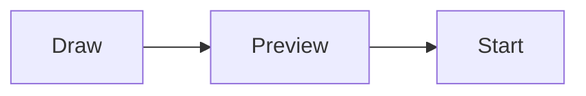

# Contributing to the manual

The manual is written in Markdown and lives in the KizamuBeam repository, in the [`manual/`](https://github.com/negurvulkan/kizamubeam/tree/main/manual) folder. Every change goes through a pull request and is published automatically once it is merged.

## Small fixes

Every page has an **Edit this page** link at the bottom. It opens the file on GitHub, where you can change it and propose the change as a pull request, right in the browser.

## Where the files are

| Path | Content |
|---|---|
| `manual/docs/` | English pages (the original) |
| `manual/i18n/de/docusaurus-plugin-content-docs/current/` | German pages |
| `manual/i18n/it/docusaurus-plugin-content-docs/current/` | Italian pages |
| `manual/i18n/<lang>/*.json` | Translated navigation, footer and sidebar labels |
| `manual/static/img/` | Screenshots and images |

Each folder in `docs/` is a chapter in the sidebar. Its `_category_.json` sets the chapter’s title and position; `sidebar_position` in a page’s front matter sets the order inside the chapter. A folder that only holds an `index.md` appears as a single page; once it gets more pages, add a `_category_.json` and translate its label in `manual/i18n/<lang>/docusaurus-plugin-content-docs/current.json`.

## Writing a page

A page starts with front matter:

```md
---
sidebar_position: 2
title: Nesting
description: One sentence that search engines and link previews show.
---

# Nesting

Text …
```

Guidelines:

- Write for users, not developers: say what something is for, then where to find it (**Menu → Entry**) and how to use it.
- Use the names the app shows in English, in bold.
- Short sentences, one topic per page, link to related pages.
- Do not compare KizamuBeam with other laser programs.
- New features: when a pull request adds a user-visible function, it should also add or update the matching manual page (at least in English).

## Screenshots

- Save screenshots as PNG or WebP in `manual/static/img/`, with the language in the name, e.g. `nesting-dialog-en.png` and `nesting-dialog-de.png`.
- Use the light theme and a window of about 1500 × 950 pixels, so that screenshots look alike.
- Take them with the current version of the app, and replace them when the interface changes.
- Embed them with a description for screen readers: ``.

## Diagrams and videos

Diagrams are written as [Mermaid](https://mermaid.js.org/) code blocks and drawn on the page:

````md

````

Videos are embedded with an `iframe`, for example from YouTube without cookies:

```html
<iframe width="560" height="315" src="https://www.youtube-nocookie.com/embed/VIDEO_ID"
  title="Video title" allowFullScreen></iframe>
```

Info boxes use `:::tip`, `:::note`, `:::info` and `:::warning`.

## Translations

English is the original. German and Italian pages have the same file names and folders under `manual/i18n/<lang>/docusaurus-plugin-content-docs/current/`. If a translation is missing, the English page is shown instead, so a page can be translated later.

To add a new language, add it to `i18n.locales` in `manual/docusaurus.config.ts` and run `npm run write-translations -- --locale <lang>` in `manual/` to create the label files.

## Previewing locally

You need Node.js 20 or newer.

```bash
cd manual
npm ci
npm start              # English, reloads on every change
npm run start:de       # German
npm run build          # everything, as it will be published
npm run serve          # look at the result of the build
```

The search only works in the result of `npm run build`.
