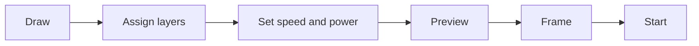

# Your first project

In this walkthrough you make a small name tag: a rounded rectangle that is cut out and a name that is engraved. It takes about ten minutes and shows the basic workflow you will use for every job.

:::info Before you start
Your laser should be connected and set up, see [Connecting a laser](connect-laser.md). Without a laser you can follow along anyway and stop before the last step, or try the job on the [KizamuBeam Virtual Machine](https://github.com/negurvulkan/kizamubeam/releases?q=vm-v), a virtual laser for testing.
:::

## 1. Draw the tag

1. Choose the **rectangle** tool (Ctrl+R) and drag a rectangle on the workspace.
2. In the numeric edits toolbar at the top, set the width to `80` and the height to `30` (mm). The fields accept formulas, too.
3. Round the corners with the corner radius field in the same bar, for example `4`.

## 2. Add the name

1. Choose the **text** tool (Ctrl+T), click inside the rectangle and type a name.
2. Pick a font and a height in the text toolbar. Any installed font works, and Google Fonts can be added with **File → Fonts …**.
3. Press Esc to go back to the select tool. Select the text and the rectangle and centre them on each other with **C** (horizontal centre) and **E** (vertical centre).

## 3. Put the parts on layers

The colour of an object is its layer, and the layer decides how it is lasered.

1. Select the text and click a colour in the palette at the bottom, for example black. The text now uses that layer.
2. Select the rectangle and click another colour, for example red.

## 4. Set up the layers

In the layers window on the right:

1. Set the text layer to mode **Fill**, so that the letters are engraved line by line.
2. Leave the rectangle layer on **Line**, so that the outline is cut.
3. Enter speed and power for your material. If you do not know them yet, run a **material test** first (**Laser → Tests and Calibration → Material Test**) or start from the values your laser’s manufacturer recommends. The material library stores what works.

Double-click a layer for more options, such as several passes, line interval, tabs and kerf offset.

## 5. Check the job

1. **Laser → Check Design** finds open outlines, double lines and parts that are too small, before you waste material.
2. Press **Alt+P** for the preview. It plays back the job, shows the travel moves and estimates the time.

## 6. Laser it

1. Place the material, focus the laser and put on eye protection.
2. In the **Laser** window choose where the job starts (absolute coordinates, user origin or the current position).
3. Click **Frame**: the head traces the outline of the job, so you can see whether it fits on the material.
4. Click **Start**. You can pause and stop at any time and adjust power and speed while the job runs.

:::warning Stay with your laser
Never leave a running laser unattended, keep the lid or a fire extinguisher at hand and make sure the exhaust is running.
:::

## 7. Save the project

**File → Save** (Ctrl+S) stores the project as a `.kzb` file, with all images embedded. KizamuBeam also keeps an automatic backup, so open tabs come back after a restart.

**File → Save as template …** turns a project into a reusable template: for a name tag, the name could be a parameter that is asked for every time.
