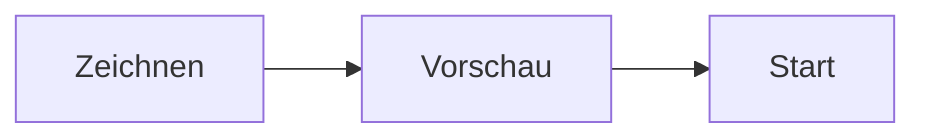

# Am Handbuch mitarbeiten

Das Handbuch ist in Markdown geschrieben und liegt im KizamuBeam-Repository im Ordner [`manual/`](https://github.com/negurvulkan/kizamubeam/tree/main/manual). Jede Änderung läuft über einen Pull Request und wird nach dem Mergen automatisch veröffentlicht.

## Kleine Korrekturen

Unten auf jeder Seite steht **Diese Seite bearbeiten**. Der Link öffnet die Datei auf GitHub, wo du sie direkt im Browser ändern und als Pull Request vorschlagen kannst.

## Wo die Dateien liegen

| Pfad | Inhalt |
|---|---|
| `manual/docs/` | Englische Seiten (das Original) |
| `manual/i18n/de/docusaurus-plugin-content-docs/current/` | Deutsche Seiten |
| `manual/i18n/it/docusaurus-plugin-content-docs/current/` | Italienische Seiten |
| `manual/i18n/<sprache>/*.json` | Übersetzte Navigation, Fußzeile und Seitenleiste |
| `manual/static/img/` | Screenshots und Bilder |

Jeder Ordner in `docs/` ist ein Kapitel in der Seitenleiste. Seine `_category_.json` legt Titel und Position fest; `sidebar_position` im Kopf einer Seite bestimmt die Reihenfolge im Kapitel. Ein Ordner mit nur einer `index.md` erscheint als einzelne Seite; bekommt er weitere Seiten, braucht er eine `_category_.json`, deren Titel in `manual/i18n/<sprache>/docusaurus-plugin-content-docs/current.json` übersetzt wird.

## Eine Seite schreiben

Eine Seite beginnt mit einem Kopf (Front Matter):

```md
---
sidebar_position: 2
title: Verschachteln
description: Ein Satz, den Suchmaschinen und Linkvorschauen zeigen.
---

# Verschachteln

Text …
```

Leitlinien:

- Schreib für Anwender, nicht für Entwickler: erst wozu etwas gut ist, dann wo es zu finden ist (**Menü → Eintrag**) und wie man es benutzt.
- Verwende die Namen, die die App in der jeweiligen Sprache zeigt, fett gesetzt.
- Kurze Sätze, ein Thema pro Seite, Links zu verwandten Seiten.
- Keine Vergleiche von KizamuBeam mit anderen Laserprogrammen.
- Neue Funktionen: Bringt ein Pull Request eine sichtbare Funktion, sollte er auch die passende Handbuchseite anlegen oder ergänzen (mindestens auf Englisch).

## Screenshots

- Speichere Screenshots als PNG oder WebP in `manual/static/img/`, mit der Sprache im Namen, z. B. `nesting-dialog-en.png` und `nesting-dialog-de.png`.
- Nimm das helle Design und ein Fenster von etwa 1500 × 950 Pixeln, damit die Bilder einheitlich aussehen.
- Nimm sie mit der aktuellen App-Version auf und ersetze sie, wenn sich die Oberfläche ändert.
- Bette sie mit einer Beschreibung für Screenreader ein: ``.

## Diagramme und Videos

Diagramme schreibst du als [Mermaid](https://mermaid.js.org/)-Codeblock, sie werden auf der Seite gezeichnet:

````md

````

Videos bettest du mit einem `iframe` ein, zum Beispiel von YouTube ohne Cookies:

```html
<iframe width="560" height="315" src="https://www.youtube-nocookie.com/embed/VIDEO_ID"
  title="Videotitel" allowFullScreen></iframe>
```

Hinweiskästen gibt es mit `:::tip`, `:::note`, `:::info` und `:::warning`.

## Übersetzungen

Englisch ist das Original. Deutsche und italienische Seiten haben dieselben Dateinamen und Ordner unter `manual/i18n/<sprache>/docusaurus-plugin-content-docs/current/`. Fehlt eine Übersetzung, wird die englische Seite gezeigt; eine Seite kann also später übersetzt werden.

Für eine neue Sprache trägst du sie unter `i18n.locales` in `manual/docusaurus.config.ts` ein und führst in `manual/` `npm run write-translations -- --locale <sprache>` aus, um die Dateien für die Beschriftungen anzulegen.

## Lokal ansehen

Du brauchst Node.js 20 oder neuer.

```bash
cd manual
npm ci
npm start              # Englisch, lädt bei jeder Änderung neu
npm run start:de       # Deutsch
npm run build          # alles, so wie es veröffentlicht wird
npm run serve          # das Ergebnis des Builds ansehen
```

Die Suche funktioniert nur im Ergebnis von `npm run build`.
