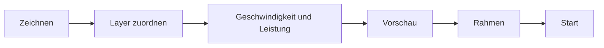

# Dein erstes Projekt

In diesem Rundgang machst du ein kleines Namensschild: ein abgerundetes Rechteck, das ausgeschnitten wird, und einen Namen, der graviert wird. Das dauert etwa zehn Minuten und zeigt den Ablauf, den du für jeden Job brauchst.

:::info Bevor du anfängst
Dein Laser sollte verbunden und eingerichtet sein, siehe [Laser verbinden](connect-laser.md). Ohne Laser kannst du trotzdem mitmachen und vor dem letzten Schritt aufhören, oder den Job mit der [KizamuBeam Virtual Machine](https://github.com/negurvulkan/kizamubeam/releases?q=vm-v) ausprobieren, einem virtuellen Laser zum Testen.
:::

## 1. Das Schild zeichnen

1. Wähle das Werkzeug **Rechteck** (Ctrl+R) und ziehe ein Rechteck auf der Arbeitsfläche auf.
2. Setze in der Eigenschaftenleiste oben die Breite auf `80` und die Höhe auf `30` (mm). Die Felder verstehen auch Formeln.
3. Runde die Ecken mit dem Feld Eckenradius in derselben Leiste ab, zum Beispiel `4`.

## 2. Den Namen hinzufügen

1. Wähle das Werkzeug **Text** (Ctrl+T), klicke in das Rechteck und tippe einen Namen.
2. Wähle in der Textleiste Schrift und Höhe. Jede installierte Schrift geht, Google Fonts fügst du mit **Datei → Schriften …** hinzu.
3. Mit Esc kommst du zurück zum Auswahlwerkzeug. Wähle Text und Rechteck aus und zentriere sie mit **C** (waagerecht) und **E** (senkrecht) aufeinander.

## 3. Die Teile auf Layer legen

Die Farbe eines Objekts ist sein Layer, und der Layer bestimmt, wie es gelasert wird.

1. Wähle den Text aus und klicke unten in der Palette auf eine Farbe, zum Beispiel Schwarz. Der Text liegt jetzt auf diesem Layer.
2. Wähle das Rechteck aus und klicke auf eine andere Farbe, zum Beispiel Rot.

## 4. Die Layer einrichten

Im Fenster Schnitte / Layer rechts:

1. Stelle den Layer des Textes auf den Modus **Füllen**, damit die Buchstaben Zeile für Zeile graviert werden.
2. Lass den Layer des Rechtecks auf **Linie**, damit der Umriss geschnitten wird.
3. Trage Geschwindigkeit und Leistung für dein Material ein. Kennst du sie noch nicht, mach zuerst einen **Materialtest** (**Laser → Test und Kalibrieren → Materialtest**) oder starte mit den Werten, die der Hersteller deines Lasers empfiehlt. Die Materialbibliothek merkt sich, was funktioniert.

Ein Doppelklick auf einen Layer zeigt weitere Optionen, etwa mehrere Durchgänge, Zeilenabstand, Haltestege und Schnittbreitenausgleich.

## 5. Den Job prüfen

1. **Laser → Konstruktion prüfen** findet offene Umrisse, doppelte Linien und zu kleine Teile, bevor du Material verschwendest.
2. **Alt+P** öffnet die Vorschau. Sie spielt den Job ab, zeigt die Leerfahrten und schätzt die Zeit.

## 6. Lasern

1. Lege das Material ein, fokussiere den Laser und setze die Schutzbrille auf.
2. Wähle im Fenster **Laser**, wo der Job beginnt (absolute Koordinaten, Benutzer-Ursprung oder aktuelle Position).
3. Klicke auf **Rahmen**: Der Kopf fährt den Umriss des Jobs ab, so siehst du, ob er aufs Material passt.
4. Klicke auf **Start**. Du kannst jederzeit pausieren und stoppen und während des Jobs Leistung und Geschwindigkeit anpassen.

:::warning Bleib beim Laser
Lass einen laufenden Laser nie unbeaufsichtigt, halte Deckel oder Feuerlöscher bereit und sorge dafür, dass die Absaugung läuft.
:::

## 7. Das Projekt speichern

**Datei → Speichern** (Ctrl+S) legt das Projekt als `.kzb`-Datei ab, Bilder sind darin enthalten. KizamuBeam legt außerdem automatisch eine Sicherung an, offene Tabs sind nach einem Neustart wieder da.

**Datei → Als Vorlage speichern …** macht aus einem Projekt eine wiederverwendbare Vorlage: Beim Namensschild könnte der Name ein Parameter sein, der jedes Mal abgefragt wird.
