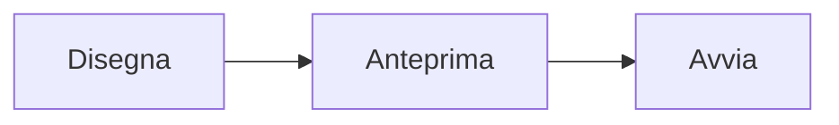

# Contribuire al manuale

Il manuale è scritto in Markdown e si trova nel repository di KizamuBeam, nella cartella [`manual/`](https://github.com/negurvulkan/kizamubeam/tree/main/manual). Ogni modifica passa da una pull request e viene pubblicata automaticamente dopo il merge.

## Piccole correzioni

In fondo a ogni pagina c’è il link **Modifica questa pagina**. Apre il file su GitHub, dove puoi modificarlo e proporre la modifica come pull request, direttamente dal browser.

## Dove si trovano i file

| Percorso | Contenuto |
|---|---|
| `manual/docs/` | Pagine in inglese (l’originale) |
| `manual/i18n/de/docusaurus-plugin-content-docs/current/` | Pagine in tedesco |
| `manual/i18n/it/docusaurus-plugin-content-docs/current/` | Pagine in italiano |
| `manual/i18n/<lingua>/*.json` | Etichette tradotte di navigazione, piè di pagina e barra laterale |
| `manual/static/img/` | Screenshot e immagini |

Ogni cartella in `docs/` è un capitolo nella barra laterale. Il suo `_category_.json` ne stabilisce titolo e posizione; `sidebar_position` nell’intestazione di una pagina ne stabilisce l’ordine nel capitolo. Una cartella che contiene solo un `index.md` compare come pagina singola; quando riceve altre pagine, serve un `_category_.json`, il cui titolo si traduce in `manual/i18n/<lingua>/docusaurus-plugin-content-docs/current.json`.

## Scrivere una pagina

Una pagina inizia con un’intestazione (front matter):

```md
---
sidebar_position: 2
title: Nesting
description: Una frase che mostrano i motori di ricerca e le anteprime dei link.
---

# Nesting

Testo …
```

Linee guida:

- Scrivi per gli utenti, non per gli sviluppatori: prima a cosa serve una funzione, poi dove si trova (**Menu → Voce**) e come si usa.
- Usa i nomi che l’app mostra nella rispettiva lingua, in grassetto.
- Frasi brevi, un argomento per pagina, link alle pagine correlate.
- Niente confronti tra KizamuBeam e altri programmi laser.
- Nuove funzioni: quando una pull request aggiunge una funzione visibile, dovrebbe anche aggiungere o aggiornare la pagina del manuale corrispondente (almeno in inglese).

## Screenshot

- Salva gli screenshot come PNG o WebP in `manual/static/img/`, con la lingua nel nome, ad es. `nesting-dialog-en.png` e `nesting-dialog-it.png`.
- Usa il tema chiaro e una finestra di circa 1500 × 950 pixel, così gli screenshot si somigliano.
- Catturali con la versione attuale dell’app e sostituiscili quando l’interfaccia cambia.
- Inseriscili con una descrizione per i lettori di schermo: ``.

## Diagrammi e video

I diagrammi si scrivono come blocchi di codice [Mermaid](https://mermaid.js.org/) e vengono disegnati sulla pagina:

````md

````

I video si incorporano con un `iframe`, per esempio da YouTube senza cookie:

```html
<iframe width="560" height="315" src="https://www.youtube-nocookie.com/embed/VIDEO_ID"
  title="Titolo del video" allowFullScreen></iframe>
```

I riquadri informativi si creano con `:::tip`, `:::note`, `:::info` e `:::warning`.

## Traduzioni

L’inglese è l’originale. Le pagine in tedesco e in italiano hanno gli stessi nomi di file e cartelle in `manual/i18n/<lingua>/docusaurus-plugin-content-docs/current/`. Se manca una traduzione viene mostrata la pagina inglese, quindi una pagina si può tradurre anche in seguito.

Per aggiungere una nuova lingua, inseriscila in `i18n.locales` in `manual/docusaurus.config.ts` ed esegui `npm run write-translations -- --locale <lingua>` in `manual/` per creare i file delle etichette.

## Anteprima in locale

Serve Node.js 20 o successivo.

```bash
cd manual
npm ci
npm start              # inglese, si ricarica a ogni modifica
npm run start:it       # italiano
npm run build          # tutto, come verrà pubblicato
npm run serve          # guarda il risultato del build
```

La ricerca funziona solo nel risultato di `npm run build`.
