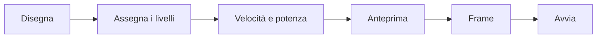

# Il tuo primo progetto

In questa guida realizzi una piccola targhetta con il nome: un rettangolo arrotondato che viene tagliato e un nome che viene inciso. Ci vogliono circa dieci minuti e vedrai il flusso di lavoro di base che userai per ogni lavoro.

:::info Prima di iniziare
Il laser dovrebbe essere collegato e configurato, vedi [Collegare un laser](connect-laser.md). Senza laser puoi seguire comunque e fermarti prima dell’ultimo passo, oppure provare il lavoro con la [KizamuBeam Virtual Machine](https://github.com/negurvulkan/kizamubeam/releases?q=vm-v), un laser virtuale per i test.
:::

## 1. Disegna la targhetta

1. Scegli lo strumento **Rettangolo** (Ctrl+R) e trascina un rettangolo sull’area di lavoro.
2. Nella barra delle modifiche numeriche in alto imposta la larghezza a `80` e l’altezza a `30` (mm). I campi accettano anche formule.
3. Arrotonda gli angoli con il campo del raggio degli angoli nella stessa barra, per esempio `4`.

## 2. Aggiungi il nome

1. Scegli lo strumento **Testo** (Ctrl+T), fai clic dentro il rettangolo e scrivi un nome.
2. Scegli font e altezza nella barra del testo. Va bene qualsiasi font installato, e i Google Fonts si aggiungono con **File → Font …**.
3. Premi Esc per tornare allo strumento di selezione. Seleziona testo e rettangolo e centrali l’uno sull’altro con **C** (in orizzontale) ed **E** (in verticale).

## 3. Metti le parti sui livelli

Il colore di un oggetto è il suo livello, e il livello decide come viene lavorato.

1. Seleziona il testo e fai clic su un colore nella tavolozza in basso, per esempio il nero. Ora il testo usa quel livello.
2. Seleziona il rettangolo e fai clic su un altro colore, per esempio il rosso.

## 4. Imposta i livelli

Nella finestra Tagli / Livello a destra:

1. Imposta il livello del testo sulla modalità **Riempimento**, così le lettere vengono incise riga per riga.
2. Lascia il livello del rettangolo su **Linea**, così il contorno viene tagliato.
3. Inserisci velocità e potenza per il tuo materiale. Se non le conosci ancora, fai prima un **test del materiale** (**Laser → Test e calibrazione → Test del materiale**) oppure parti dai valori consigliati dal produttore del laser. La libreria materiali conserva ciò che funziona.

Un doppio clic su un livello mostra altre opzioni, come più passate, interlinea, ponticelli e compensazione del kerf.

## 5. Controlla il lavoro

1. **Laser → Controlla progetto** trova contorni aperti, linee doppie e parti troppo piccole, prima di sprecare materiale.
2. **Alt+P** apre l’anteprima. Riproduce il lavoro, mostra gli spostamenti a vuoto e stima il tempo.

## 6. Incidi

1. Posiziona il materiale, metti a fuoco il laser e indossa gli occhiali di protezione.
2. Nella finestra **Laser** scegli da dove parte il lavoro (coordinate assolute, origine utente o posizione attuale).
3. Fai clic su **Frame**: la testa percorre il contorno del lavoro, così vedi se entra nel materiale.
4. Fai clic su **Avvia**. Puoi mettere in pausa e fermare in qualsiasi momento e regolare potenza e velocità durante il lavoro.

:::warning Resta vicino al laser
Non lasciare mai un laser in funzione senza sorveglianza, tieni a portata di mano il coperchio o un estintore e assicurati che l’aspirazione sia accesa.
:::

## 7. Salva il progetto

**File → Salva** (Ctrl+S) salva il progetto come file `.kzb`, con tutte le immagini incluse. KizamuBeam crea anche un backup automatico, così le schede aperte tornano dopo un riavvio.

**File → Salva come modello …** trasforma un progetto in un modello riutilizzabile: per una targhetta, il nome potrebbe essere un parametro chiesto ogni volta.
